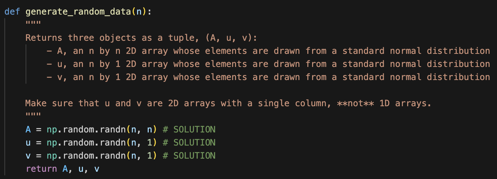
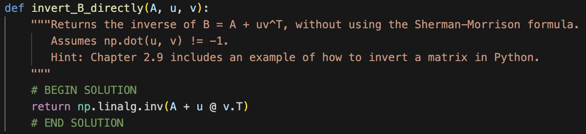
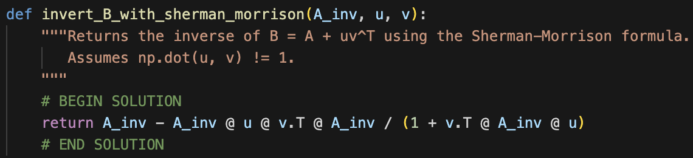
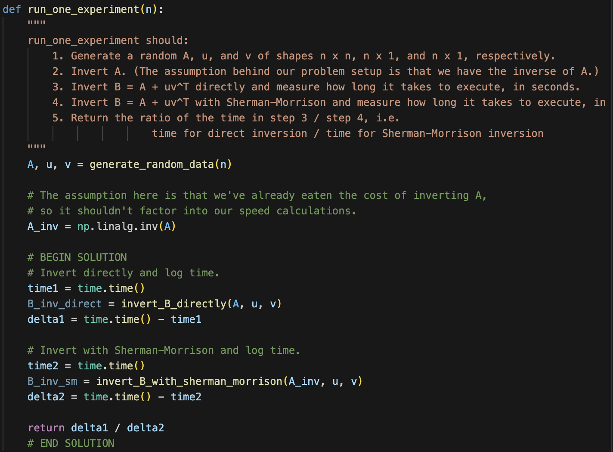
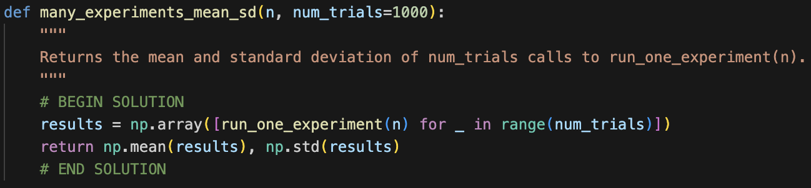
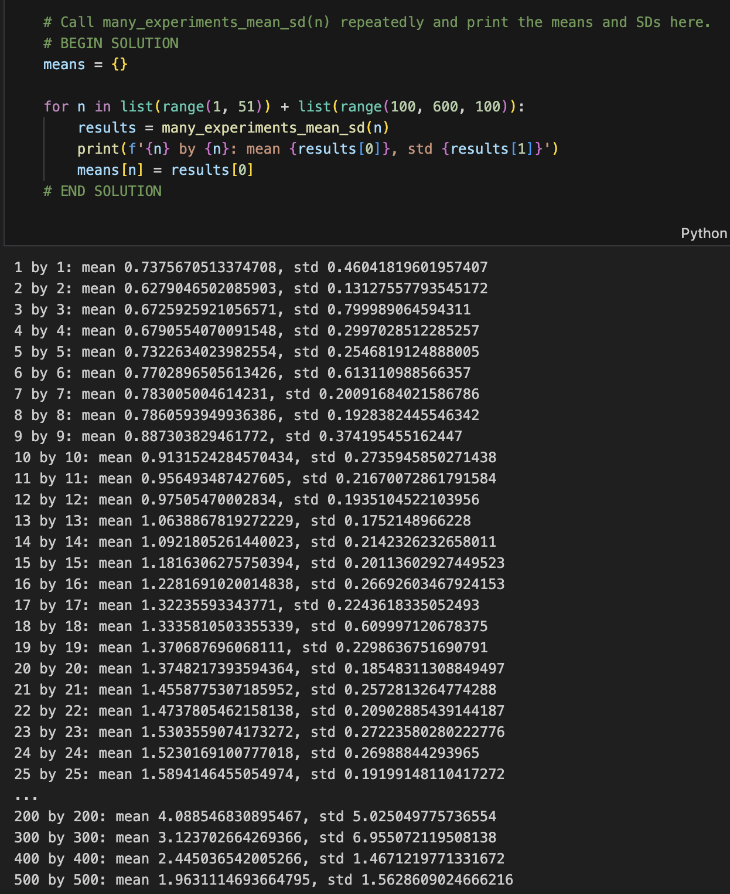



# Homework 6: Rank and Inverses

**due** Sunday, November 1st, 2026 at 11:59PM Ann Arbor Time

<a class="btn btn-info assignment-pdf-button" href="/resources/homeworks/hw06/hw06.pdf" target="_blank">View as PDF ✏️</a>
<a class="btn btn-info assignment-pdf-button" href="/resources/homeworks/hw06/hw06-solutions.pdf" target="_blank">Solutions PDF ✅</a>

{: .yellow }

Except for the video link in Problem 1, write your solutions to the following problems either by writing them on a piece of paper or on a tablet and scanning your answers as a PDF. Note that you are not allowed to use LaTeX, Google Docs, or any other digital document creation software to type your answers. Homeworks are due to Pensive by 11:59PM on the due date. See the [syllabus](https://eecs245.org/syllabus/#homeworks) for details on the slip day policy.

Homework will be evaluated not only on the correctness of your answers, but on your ability to present your ideas clearly and logically. You should always explain and justify your conclusions, using sound reasoning. Your goal should be to convince the reader of your assertions. If a question does not require explanation, it will be explicitly stated.

Before proceeding, make sure you're familiar with the [collaboration policy](https://eecs245.org/syllabus/#homeworks).

---

## Problems

- [Problem 1: Homework 5 Concept Video](#problem-1-homework-5-concept-video-10-pts)
- [Problem 2: Rank-Nullity Practice](#problem-2-rank-nullity-practice-8-pts)
- [Problem 3: Spaces](#problem-3-spaces-17-pts)
- [Problem 4: Finding Inverses](#problem-4-finding-inverses-5-pts)
- [Problem 5: Inverse of a Rotation](#problem-5-inverse-of-a-rotation-8-pts)
- [Problem 6: Trickster](#problem-6-trickster-3-pts)
- [Problem 7: Numbers of Solutions](#problem-7-numbers-of-solutions-12-pts)
- [Problem 8: Diagonal and Triangular Matrices](#problem-8-diagonal-and-triangular-matrices-9-pts)
- [Problem 9: Invertibility of $XX^T$](#problem-9-invertibility-of-xxt-6-pts)
- [Problem 10: Sherman-Morrison Inverse](#problem-10-sherman-morrison-inverse-14-pts)
- [Problem 11: Canva245](#problem-11-canva245-8-pts)

---

Total Points: \\(10+8+17+5+8+3+12+9+6+14+8=100\\)

---

## Problem 1: Homework 5 Concept Video (10 pts)

Record a **2- to 5-minute video** answering **one** of the prompts below. These prompts are related to the ideas in Homework 5.

<ol class="assignment-list" markdown="1" data-item-count="4" start="1" style="list-style-type: decimal;">
<li markdown="1" value="1">

If you swap two columns of an orthogonal matrix, is the resulting matrix still orthogonal, and why?

</li>
<li markdown="1" value="2">

If you append to a matrix a new column equal to the sum of its first two columns, how can you update its \\(CR\\) decomposition, and does its rank change?

</li>
<li markdown="1" value="3">

If \\(P\\) projects onto a nonzero vector and \\(R\\) reflects across that same vector, does \\(PR=P\\), \\(PR=R\\), or neither, and why?

</li>
<li markdown="1" value="4">

Can a matrix that projects onto a nonzero vector in \\(\mathbb R^2\\) be orthogonal, and why or why not?

</li>
</ol>

The video should be **just you speaking into the camera**. Your face must be visible while you are talking for the entire video. Do not include slides, a screen recording, written work, or any other visuals.

Submit your video link to the separate assignment on Pensive called **Homework 6, Problem 1 Video Link**. You can upload your video to YouTube as unlisted, share a Zoom recording link, or share a Google Drive link; whatever works. Make sure the course staff can view the video using that link.

Your submission time for Homework 6 is the later of the two submission times: your Problem 1 video link and your regular Homework 6 PDF.

**This problem is graded on completion.** Record a video of the required length and make an honest effort to explain the question, and you will receive full credit. Your explanation does not need to be polished or perfect.

---

## Problem 2: Rank-Nullity Practice (8 pts)

In each part, identify whether the statement is true or false, and explain why.

a)

(2 pts) There exists a \\(4 \times 5\\) matrix \\(A\\) with \\(\text{rank}(A) = 4\\) and \\(\text{dim}(\text{colsp}(A)) = 3\\).

Solution

\\(\boxed{\text{False}}\\). \\(\text{rank}(A) = \text{dim}(\text{colsp}(A))\\) for any matrix \\(A\\) by definition.

b)

(2 pts) There exists a \\(4 \times 5\\) matrix \\(B\\) with \\(\text{rank}(B) = 3\\) and \\(\text{dim}(\text{nullsp}(B)) = 2\\).

Solution

\\(\boxed{\text{True}}\\). In fact, every \\(4 \times 5\\) matrix with \\(\text{rank}(B) = 3\\) must have \\(\text{dim}(\text{nullsp}(B)) = 2\\).

This is because the rank-nullity theorem tells us that

$$
\text{rank}(B) + \text{dim}(\text{nullsp}(B)) = \text{# columns in } B = 5
$$

 so if \\(\text{rank}(B) = 3\\), then \\(\text{dim}(\text{nullsp}(B)) = 2\\).

c)

(2 pts) There exists a \\(4 \times 5\\) matrix \\(C\\) with \\(\text{dim}(\text{nullsp}(C)) = 4\\) and \\(\text{dim}(\text{nullsp}(C^T)) = 1\\).

Solution

\\(\boxed{\text{False}}\\).

Suppose \\(C\\) is a \\(4 \times 5\\) matrix with \\(\text{dim}(\text{nullsp}(C)) = 4\\). Then, by the rank-nullity theorem,

$$
\text{rank}(C) + \text{dim}(\text{nullsp}(C)) = 5 \implies \text{rank}(C) = 5 - 4 = 1
$$

But then, applying the rank-nullity theorem to \\(C^T\\) and using the fact that \\(\text{rank}(C^T) = \text{rank}(C) = 1\\), we have

$$
\text{rank}(C^T) + \text{dim}(\text{nullsp}(C^T)) = 4 \implies \text{dim}(\text{nullsp}(C^T)) = 4 - 1 = 3
$$

But, the question states that \\(\text{dim}(\text{nullsp}(C^T)) = 1\\), so we have a contradiction. Therefore, no such matrix \\(C\\) exists.

d)

(2 pts) There exists an invertible \\(3 \times 3\\) matrix \\(D\\) with \\(\text{dim}(\text{nullsp}(D^T)) = 1\\).

Solution

\\(\boxed{\text{False}}\\). Since \\(D\\) is invertible, \\(\text{rank}(D)=3\\). We know that \\(D\\) and \\(D^T\\) have the same rank, so \\(\text{rank}(D^T)=3\\), too. Then, by the rank-nullity theorem,

$$
\text{rank}(D^T)+\text{dim}(\text{nullsp}(D^T))=3
\implies \text{dim}(\text{nullsp}(D^T))=0
$$

 But, the question states that \\(\text{dim}(\text{nullsp}(D^T))=1\\), so we have a contradiction. Therefore, no such matrix \\(D\\) exists.

---

## Problem 3: Spaces (17 pts)

a)

(4 pts) Find a matrix \\(A\\) such that

$$
\text{nullsp}(A) = \text{span}\left(\left\{\begin{bmatrix} 2 \\\\ 1 \\\\ 0 \\\\ 1 \end{bmatrix}\right\}\right)
$$

What is \\(\text{rank}(A)\\)?

Solution

Recall, \\(\text{nullsp}(A)\\) is the set of all vectors \\(\vec x\\) such that \\(A\vec x = \vec 0\\). We have that:

<ol class="assignment-list" markdown="1" data-item-count="3" start="1" style="list-style-type: decimal;">
<li markdown="1" value="1">

\\(\text{nullsp}(A)\\) is a 1-dimensional subspace of \\(\mathbb{R}^4\\).

</li>
<li markdown="1" value="2">

\\(A\\) has 4 columns, because the null space is made up of vectors in \\(\mathbb{R}^4\\); \\(A\\) must have 4 columns in order for \\(A \begin{bmatrix} 2 \\\\ 1 \\\\ 0 \\\\ 1 \end{bmatrix}\\) to be a valid product.

</li>
<li markdown="1" value="3">

The above two facts imply, from the rank-nullity theorem, that \\(\text{rank}(A) + 1 = 4 \implies \text{rank}(A) = 3\\).

</li>
</ol>

We know that \\(A\\) has 3 linearly independent columns, and 4 total columns. We don't know how many rows it has, but it must have at least 3 rows since \\(\text{rank}(A) = 3\\).

The easiest solution is to make \\(A\\) a \\(3 \times 4\\) matrix. Let \\(\vec a^{(1)}, \vec a^{(2)}, \vec a^{(3)}, \vec a^{(4)}\\) be the columns of \\(A\\). Then,

$$
A\begin{bmatrix} 2 \\\\ 1 \\\\ 0 \\\\ 1 \end{bmatrix} = \begin{bmatrix} | & | & | & | \\\\ \vec a^{(1)} & \vec a^{(2)} & \vec a^{(3)} & \vec a^{(4)} \\\\ | & | & | & |\end{bmatrix} \begin{bmatrix} 2 \\\\ 1 \\\\ 0 \\\\ 1 \end{bmatrix} = \vec 0
$$

 implies that \\(A\\)'s columns must satisfy

$$
2 \vec a^{(1)} + \vec a^{(2)} + \vec a^{(4)} = \vec 0
$$

So, we just need to pick 4 vectors in \\(\mathbb{R}^3\\) such that one of them is a linear combination of the others, and the above relationship is satisfied. The above relationship gives us a dependency relationship between \\(\vec a^{(1)}\\), \\(\vec a^{(2)}\\), and \\(\vec a^{(4)}\\), so we can accomplish both goals at the same time.

Let's pick \\(\vec a^{(1)} = \begin{bmatrix} 1 \\\\ 0 \\\\ 0 \end{bmatrix}\\), \\(\vec a^{(2)} = \begin{bmatrix} 0 \\\\ 1 \\\\ 0 \end{bmatrix}\\), and \\(\vec a^{(3)} = \begin{bmatrix} 0 \\\\ 0 \\\\ 1 \end{bmatrix}\\). There's nothing special about these choices other than that the numbers are small and simple; you could have picked any three linearly independent vectors. Note that \\(\vec a^{(3)}\\) doesn't appear in the relationship above; \\(\vec a^{(1)}\\), \\(\vec a^{(2)}\\), and \\(\vec a^{(4)}\\) all do, so now we can find the required \\(\vec a^{(4)}\\) by solving the equation \\(2 \vec a^{(1)} + \vec a^{(2)} + \vec a^{(4)} = \vec 0\\).

$$
\vec a^{(4)} = -2 \vec a^{(1)} - \vec a^{(2)} = \begin{bmatrix} -2 \\\\ -1 \\\\ 0 \end{bmatrix}
$$

So, one possible \\(A\\) is \\(\boxed{A = \begin{bmatrix} 1 &amp; 0 &amp; 0 &amp; -2 \\\\ 0 &amp; 1 &amp; 0 &amp; -1 \\\\ 0 &amp; 0 &amp; 1 &amp; 0 \end{bmatrix}}\\), which has \\(\boxed{\text{rank}(A) = 3}\\).

b)

(4 pts) Find a matrix \\(A\\) such that

$$
\text{nullsp}(A) = \text{span}\left(\left\{\begin{bmatrix} 2 \\\\ 2 \\\\ 1 \\\\ 0 \end{bmatrix}, \begin{bmatrix} 3 \\\\ 1 \\\\ 0 \\\\ 1 \end{bmatrix}\right\}\right)
$$

What is \\(\text{rank}(A)\\)?

Solution

Following the logic from the last subpart, \\(\text{dim}(\text{nullsp}(A)) = 2\\) and \\(A\\) must have 4 columns, so

$$
\text{rank}(A) = 4 - 2 = 2
$$

So, the easiest example will involve a \\(2 \times 4\\) matrix \\(A\\). If \\(A = \begin{bmatrix} | &amp; | &amp; | &amp; | \\\\ \vec a^{(1)} &amp; \vec a^{(2)} &amp; \vec a^{(3)} &amp; \vec a^{(4)} \\\\ | &amp; | &amp; | &amp; |\end{bmatrix}\\), then it must be the case that

\\(A \begin{bmatrix} 2 \\\\ 2 \\\\ 1 \\\\ 0 \end{bmatrix} = \vec 0\\) and \\(A \begin{bmatrix} 3 \\\\ 1 \\\\ 0 \\\\ 1 \end{bmatrix} = \vec 0\\). This gives us two conditions on \\(\vec a^{(1)}, \vec a^{(2)}, \vec a^{(3)}, \vec a^{(4)}\\):

$$
2 \vec a^{(1)} + 2 \vec a^{(2)} + \vec a^{(3)} = \vec 0
$$

$$
3 \vec a^{(1)} + \vec a^{(2)} + \vec a^{(4)} = \vec 0
$$

\\(\vec a^{(1)}\\) and \\(\vec a^{(2)}\\) appear in both equations, so it might be easiest to make those the two linearly independent columns (remember that \\(\text{rank}(A) = 2\\)). So, let's make them \\(\vec a^{(1)} = \begin{bmatrix} 1 \\\\ 0 \end{bmatrix}\\) and \\(\vec a^{(2)} = \begin{bmatrix} 0 \\\\ 1 \end{bmatrix}\\). Now, we can solve for \\(\vec a^{(3)}\\) and \\(\vec a^{(4)}\\) by solving the two equations:

$$
\vec a^{(3)} = -2 \vec a^{(1)} - 2 \vec a^{(2)} = \begin{bmatrix} -2 \\\\ -2 \end{bmatrix}
$$

$$
\vec a^{(4)} = -3 \vec a^{(1)} - \vec a^{(2)} = \begin{bmatrix} -3 \\\\ -1 \end{bmatrix}
$$

So, one possible \\(A\\) is \\(\boxed{A = \begin{bmatrix} 1 &amp; 0 &amp; -2 &amp; -3 \\\\ 0 &amp; 1 &amp; -2 &amp; -1 \end{bmatrix}}\\), which has \\(\boxed{\text{rank}(A) = 2}\\).

Just to verify that we did this correctly, let's take a linear combination of \\(\begin{bmatrix} 2 \\\\ 2 \\\\ 1 \\\\ 0 \end{bmatrix}\\) and \\(\begin{bmatrix} 3 \\\\ 1 \\\\ 0 \\\\ 1 \end{bmatrix}\\) and check that multiplying \\(A\\) by that linear combination gets us to \\(\vec 0\\). How about

$$
\vec v = 5 \begin{bmatrix} 2 \\\\ 2 \\\\ 1 \\\\ 0 \end{bmatrix} + 2 \begin{bmatrix} 3 \\\\ 1 \\\\ 0 \\\\ 1 \end{bmatrix} = \begin{bmatrix} 16 \\\\ 12 \\\\ 5 \\\\ 2 \end{bmatrix}
$$

Indeed,

$$
A \vec v = \begin{bmatrix} 1 & 0 & -2 & -3 \\\\ 0 & 1 & -2 & -1 \end{bmatrix} \begin{bmatrix} 16 \\\\ 12 \\\\ 5 \\\\ 2 \end{bmatrix} = \begin{bmatrix} 16 - 2 \cdot 5 - 3 \cdot 2 \\\\ 12 - 2 \cdot 5 - 1 \cdot 2 \end{bmatrix} = \begin{bmatrix} 0 \\\\ 0 \end{bmatrix} = \vec 0
$$

so it seems like we found a valid \\(A\\).

c)

(5 pts) Find a matrix \\(A\\) such that

$$
\begin{bmatrix} 1 \\\\ 1 \\\\ 5 \end{bmatrix} \in \text{colsp}(A), \quad \begin{bmatrix} 0 \\\\ 3 \\\\ 1 \end{bmatrix} \in \text{colsp}(A), \quad \begin{bmatrix} 1 \\\\ 1 \\\\ 2 \end{bmatrix} \in \text{nullsp}(A)
$$

What is \\(\text{rank}(A)\\)?

Solution

We know that \\(A\\) has 3 rows, because \\(\begin{bmatrix} 1 \\\\ 1 \\\\ 5 \end{bmatrix}\\) is a linear combination of \\(A\\)'s columns, which must be in \\(\mathbb{R}^3\\). It also has 3 columns, because the null space is made up of vectors in \\(\mathbb{R}^3\\); \\(A\\) must have 3 columns in order for \\(A \begin{bmatrix} 1 \\\\ 1 \\\\ 2 \end{bmatrix}\\) to be a valid product.

So, \\(A\\) is a \\(3 \times 3\\) matrix.

There are two linearly independent columns in the column space of \\(A\\), so \\(A\\) must have at least 2 linearly independent columns, meaning \\(\text{rank}(A) \geq 2\\). However, the null space contains a non-zero vector, so \\(A\\) must have exactly 2 linearly independent columns and a null space of dimension 1, meaning \\(\text{rank}(A) = 2\\).

The easiest path forward is to make \\(A\\) a \\(3 \times 3\\) matrix whose first column is \\(\begin{bmatrix} 1 \\\\ 1 \\\\ 5 \end{bmatrix}\\) and whose second column is \\(\begin{bmatrix} 0 \\\\ 3 \\\\ 1 \end{bmatrix}\\). Then, we can solve for the third column by solving the equation \\(A \begin{bmatrix} 1 \\\\ 1 \\\\ 2 \end{bmatrix} = \vec 0\\) (or \\(A \begin{bmatrix} 2 \\\\ 2 \\\\ 4 \end{bmatrix} = \vec 0\\), or \\(A (\text{any scalar multiple of } \begin{bmatrix} 1 \\\\ 1 \\\\ 2 \end{bmatrix}) = \vec 0\\)).

If we let \\(A = \begin{bmatrix}1 &amp; 0 &amp; c&#95;1 \\\\ 1 &amp; 3 &amp; c&#95;2 \\\\ 5 &amp; 1 &amp; c&#95;3 \end{bmatrix}\\), then we have the following system of equations:

$$
\begin{align*}
A\begin{bmatrix} 1 \\\\ 1 \\\\ 2 \end{bmatrix} &= \vec{0} \\\\
\implies \begin{bmatrix} 1 & 0 & c_1 \\\\ 1 & 3 & c_2 \\\\ 5 & 1 & c_3 \end{bmatrix}
\begin{bmatrix} 1 \\\\ 1 \\\\ 2 \end{bmatrix} &=
\begin{bmatrix}
1 \cdot 1 + 0 \cdot 1 + c_1 \cdot 2 \\\\
1 \cdot 1 + 3 \cdot 1 + c_2 \cdot 2 \\\\
5 \cdot 1 + 1 \cdot 1 + c_3 \cdot 2 \\\\
\end{bmatrix}
=
\begin{bmatrix}
1 + 2c_1 \\\\
4 + 2c_2 \\\\
6 + 2c_3
\end{bmatrix}
= \vec{0}
\end{align*}
$$

This is satisfied by \\(c&#95;1 = -\frac{1}{2}\\), \\(c&#95;2 = -2\\), and \\(c&#95;3 = -3\\), so one possible \\(A\\) is \\(\boxed{A = \begin{bmatrix} 1 &amp; 0 &amp; -\frac{1}{2} \\\\ 1 &amp; 3 &amp; -2 \\\\ 5 &amp; 1 &amp; -3 \end{bmatrix}}\\), with \\(\boxed{\text{rank}(A) = 2}\\).

d)

(4 pts) Let \\(\vec u = \begin{bmatrix} 1 \\\\ 3 \\\\ 4 \end{bmatrix}\\) and \\(\vec v = \begin{bmatrix} 8 \\\\ -2 \\\\ 3 \end{bmatrix}\\). Explain why there **does not** exist a matrix \\(A\\) such that

$$
\vec u \in \text{colsp}(A), \quad \vec v \in \text{nullsp}(A^T)
$$

and propose one change we could make to \\(\vec v\\) that would allow such an \\(A\\) to exist.

<em>Hint: In the <a href="https://notes.eecs245.org/matrices/null-space-rank-nullity/#example-orthogonal-complements">Orthogonal Complements example in Chapter 5.4</a>, and in <a href="https://youtu.be/dcqA-6-vYA4">this video</a>, we discuss a fact related to this question. If you want to make a claim about the required relationship between \\(\vec u\\) and \\(\vec v\\), you need to re-prove it here. This shouldn't take too many lines of work.</em>

Solution

The reason is that **every element of \\(\text{colsp}(A)\\) is orthogonal to every element of \\(\text{nullsp}(A^T)\\)**. Sometimes, this is phrased as the column space and null space being \\(\textbf{orthogonal complements}\\).

Why is this the case? Suppose \\(A\\) is an \\(n \times d\\) matrix where \\(\vec u \in \text{colsp}(A)\\) and \\(\vec v \in \text{nullsp}(A^T)\\). The definition of \\(\vec u \in \text{colsp}(A)\\) is that there exists some other vector \\(\vec y\\) such that

$$
\vec u = A \vec y
$$

Here, \\(\vec u \in \mathbb{R}^n\\) and \\(\vec y \in \mathbb{R}^d\\).

The definition of \\(\vec v\\) is that

$$
A^T \vec v = \vec 0
$$

Likewise, \\(\vec v \in \mathbb{R}^n\\).

Then,

$$
\vec u \cdot \vec v = (A \vec y) \cdot \vec v = (A \vec y)^T \vec v = \vec y^T A^T \vec v = \vec y^T \vec 0 = 0
$$

So, if \\(\vec u \in \text{colsp}(A)\\) and \\(\vec v \in \text{nullsp}(A^T)\\), then \\(\vec u\\) and \\(\vec v\\) must be orthogonal.

This explains why there doesn't exist a matrix \\(A\\) where \\(\begin{bmatrix} 1 \\\\ 3 \\\\ 4 \end{bmatrix} \in \text{colsp}(A)\\) and \\(\begin{bmatrix} 8 \\\\ -2 \\\\ 3 \end{bmatrix} \in \text{nullsp}(A^T)\\), since these vectors aren't orthogonal, as their dot product is \\(8 - 6 + 12 = 14 \neq 0\\).

A change to \\(\vec v\\) that would allow such an \\(A\\) to exist is to change its first component to \\(-6\\); then,

$$
\vec u \cdot \vec v = \begin{bmatrix} 1 \\\\ 3 \\\\ 4 \end{bmatrix} \cdot \begin{bmatrix} -6 \\\\ -2 \\\\ 3 \end{bmatrix} = -6 + -6 + 12 = 0
$$

---

## Problem 4: Finding Inverses (5 pts)

Suppose \\(A=BC\\), where \\(B\\) is an unknown invertible \\(2\times2\\) matrix and

$$
A=\begin{bmatrix}1&5\\\\0&3\end{bmatrix},\qquad
C=\begin{bmatrix}1&2\\\\-1&1\end{bmatrix}
$$

 Find \\(B^{-1}\\). For full credit, you may only use the formula for the inverse of a \\(2\times2\\) matrix **once**; you do not need to find \\(B\\) first.

Solution

Starting with \\(A=BC\\), multiply both sides on the left by \\(B^{-1}\\):

$$
B^{-1}A=C
$$

 Then, multiply both sides on the right by \\(A^{-1}\\) to get \\(\boxed{B^{-1}=CA^{-1}}\\). Notice that the order matters!

Using the \\(2\times2\\) inverse formula,

$$
A^{-1}=\frac{1}{3}\begin{bmatrix}3&-5\\\\0&1\end{bmatrix}
$$

 Then,

$$
B^{-1}=CA^{-1}=\frac{1}{3}\begin{bmatrix}1&2\\\\-1&1\end{bmatrix}\begin{bmatrix}3&-5\\\\0&1\end{bmatrix}=\boxed{\begin{bmatrix}1&-1\\\\-1&2\end{bmatrix}}
$$

---

## Problem 5: Inverse of a Rotation (8 pts)

As we've seen, the matrix

$$
R=\begin{bmatrix}\cos\theta&-\sin\theta\\\\\sin\theta&\cos\theta\end{bmatrix}
$$

 rotates vectors in \\(\mathbb R^2\\) counterclockwise by \\(\theta\\) radians.

a)

(2 pts) Find \\(R^{-1}\\).

Solution

The denominator in the inverse formula is \\(\cos^2\theta+\sin^2\theta=1\\), so it is nonzero for every \\(\theta\\). Then,

$$
\boxed{R^{-1}=\begin{bmatrix}\cos\theta&\sin\theta\\\\-\sin\theta&\cos\theta\end{bmatrix}}
$$

b)

(2 pts) Now, find \\(R\\) for a rotation of \\(\theta\\) radians clockwise, i.e. for \\(-\theta\\). What do you notice, and why?

Solution

Since \\(\cos(-\theta)=\cos\theta\\) and \\(\sin(-\theta)=-\sin\theta\\), the clockwise rotation matrix is \\(\boxed{\begin{bmatrix}\cos\theta&amp;\sin\theta\\\\-\sin\theta&amp;\cos\theta\end{bmatrix}=R^{-1}}\\). To undo a counterclockwise rotation by \\(\theta\\), we rotate clockwise by the same angle.

c)

(4 pts) A linear transformation \\(T:\mathbb R^2\to\mathbb R^2\\) first rotates vectors counterclockwise by \\(30^\circ\\), then multiplies their horizontal coordinates by \\(5\\) and their vertical coordinates by \\(\frac12\\). Find the matrix of \\(T^{-1}\\). <em>Hint: While it's possible to do this by first finding the matrix for \\(T\\), that is not necessary!</em>

Solution

We need to undo the transformations in reverse order. First, divide horizontal coordinates by \\(5\\) and multiply vertical coordinates by \\(2\\). Then, rotate clockwise by \\(30^\circ\\). So, the matrix of \\(T^{-1}\\) is

$$
\begin{bmatrix}\sqrt{3}/2&1/2\\\\-1/2&\sqrt{3}/2\end{bmatrix}\begin{bmatrix}1/5&0\\\\0&2\end{bmatrix}
=\boxed{\begin{bmatrix}\sqrt{3}/10&1\\\\-1/10&\sqrt{3}\end{bmatrix}}
$$

 The rightmost matrix acts first, so this product applies the inverse scaling before the inverse rotation.

---

## Problem 6: Trickster (3 pts)

Find a matrix \\(A\\) that is **not equal to the identity matrix**, but where \\(A^6 = I\\).

Once you've found your answer, explain how you found it and verify in Python that \\(A^6=I\\). You can do this either in the Terminal (as described in [**this video**](https://youtu.be/HZtoekU9NcE)), or in the supplemental notebook for this homework, linked [**here**](https://datahub.eecs245.org/hub/user-redirect/git-pull?repo=https%3A%2F%2Fgithub.com%2Feecs245%2Ffa26-code&urlpath=tree%2Ffa26-code%2Fhomeworks%2Fhw06%2Fhw06.ipynb&branch=main) on DataHub or [**here**](https://github.com/eecs245/fa26-code/blob/main/homeworks/hw06/hw06.ipynb) in the course GitHub repository. Include a screenshot of your Python code and output.

Solution

\\(A\\) could be the rotation matrix that corresponds to rotating by \\(60^\circ\\), or \\(\frac{\pi}{3}\\) radians, since applying this transformation 6 times will bring us back to the vectors we started with.

As we saw in [Chapter 6.2](https://notes.eecs245.org/linear-transformations-and-projections/linear-transformations/#rotations-and-orthogonal-matrices),

$$
R(\theta) = \begin{bmatrix} \cos \theta & -\sin \theta \\\\ \sin \theta & \cos \theta \end{bmatrix}
$$

so

$$
\boxed{A = \begin{bmatrix} \cos \frac{\pi}{3} & -\sin \frac{\pi}{3} \\\\ \sin \frac{\pi}{3} & \cos \frac{\pi}{3} \end{bmatrix} = \begin{bmatrix} \frac{1}{2} & -\frac{\sqrt{3}}{2} \\\\ \frac{\sqrt{3}}{2} & \frac{1}{2} \end{bmatrix}}
$$

A simpler answer might be \\(\boxed{A = \begin{bmatrix} 0 &amp; 1 \\\\ 1 &amp; 0 \end{bmatrix}}\\), since \\(A^2 = I\\) and so \\(A^6 = (A^2)^3 = I^3 = I\\).

---

## Problem 7: Numbers of Solutions (12 pts)

Recall that if \\(A\\) is an \\(n \times d\\) matrix, \\(\vec x \in \mathbb{R}^d\\), and \\(\vec b \in \mathbb{R}^n\\), then

$$
A \vec x = \vec b
$$

 is a system of \\(n\\) equations in \\(d\\) unknowns, where the unknowns are the components of \\(\vec x\\), i.e. \\(x&#95;1\\), \\(x&#95;2\\), \\(\ldots\\), \\(x&#95;d\\). Solving this system is equivalent to writing \\(\vec b\\) as a **linear combination of the columns of \\(A\\)**.

In each part, do two things:

<ol class="assignment-list" markdown="1" data-item-count="2" start="1" style="list-style-type: decimal;">
<li markdown="1" value="1">

Construct a matrix \\(A\\) for which the number of solutions (that is, number of valid \\(\vec x\\)'s) to the system \\(A \vec x = \vec b\\) is the number provided.

</li>
<li markdown="1" value="2">

Determine whether the function \\(f(\vec x) = A \vec x\\) is one-to-one, onto, both, or neither. (See [Chapter 6.2](https://notes.eecs245.org/linear-transformations-and-projections/inverses/#inverting-a-transformation) for a refresher on the definitions.)

</li>
</ol>

The first part has been done for you as an example.

a)

\\(0\\) or \\(1\\), depending on \\(\vec b\\)

<ol class="assignment-list" markdown="1" data-item-count="2" start="1" style="list-style-type: decimal;">
<li markdown="1" value="1">

If there are either 0 or 1 solutions, we know that \\(A\\)'s columns must be linearly independent. This is because if a given set of vectors is linearly independent, then any linear combination of them can only be written in one way (a fact that we proved in [Chapter 4.2](https://notes.eecs245.org/linear-independence/linear-independence/#unique-linear-combinations)). \\(A\\)'s columns must also **not** span all of \\(\mathbb{R}^n\\), since there are some \\(\vec b \in \mathbb{R}^n\\) with no solutions for \\(\vec x\\), so \\(A\\) must have fewer columns than rows.

One possible \\(A\\) is \\(A = \begin{bmatrix} 1 &amp; 0 \\\\ 0 &amp; 2 \\\\ 0 &amp; 0 \end{bmatrix}\\). For example, \\(\vec b = \begin{bmatrix} -3 \\\\ 4 \\\\ 0 \end{bmatrix}\\) only has a single solution for \\(\vec x\\), which is \\(\vec x = \begin{bmatrix} -3 \\\\ 2 \end{bmatrix}\\), while \\(\vec c = \begin{bmatrix} 1 \\\\ 2 \\\\ 3 \end{bmatrix}\\) has no solution for \\(\vec x\\).

</li>
<li markdown="1" value="2">

The function \\(f(\vec x) = A \vec x\\) is one-to-one, but not onto. It is one-to-one because of the fact that any linear combination of \\(A\\)'s columns can only be written in one way, so if \\(\vec x \neq \vec y\\), then \\(A \vec x\\) and \\(A \vec y\\) must also be different. It is not onto, since there are vectors in \\(\mathbb{R}^3\\) (like \\(\vec c\\) above) that aren't the output of \\(f(\vec x)\\).

</li>
</ol>

b)

(4 pts)
\\(\infty\\), no matter what \\(\vec b\\) is

Solution

For \\(A\vec x = \vec b\\) to have an infinite number of solutions, for every possible \\(\vec b \in \mathbb{R}^n\\), we need \\(A\\)'s **columns to be linearly dependent and span all of \\(\mathbb{R}^n\\)**. We need its columns to span \\(\mathbb{R}^n\\) so there's at least one solution for every \\(\vec b \in \mathbb{R}^n\\), and we need its columns to be linearly dependent so that there are infinitely many ways to write any given \\(\vec b \in \text{colsp}(A)\\) through a linear combination of \\(A\\)'s columns.

One possible \\(A\\) is \\(\boxed{A=\begin{bmatrix}1 &amp; 0 &amp; 0 &amp; 1 \\\\ 0 &amp; 1 &amp; 0 &amp; 1 \\\\ 0 &amp; 0 &amp; 1 &amp; 1\end{bmatrix}}\\). Pick any \\(\vec b \in \mathbb{R}^3\\) and there will be infinitely many vectors \\(\vec x\\) where \\(A \vec x = \vec b\\).

The function \\(f(\vec x) = A \vec x\\)\...

<ul class="assignment-list" markdown="1" data-item-count="2">
<li markdown="1">

**is onto**, because the columns of \\(A\\) span all of \\(\mathbb{R}^n\\), meaning that all vectors in \\(\mathbb{R}^n\\) are possible outputs of \\(f(\vec x)\\).

</li>
<li markdown="1">

**is not one-to-one**, because it's possible for two different vectors \\(\vec x, \vec y \in \mathbb{R}^4\\) to result in \\(A \vec x = A \vec y\\). For example, \\(A \begin{bmatrix} 1 \\\\ 1 \\\\ 1 \\\\ 1 \end{bmatrix} = A \begin{bmatrix} 0 \\\\ 0 \\\\ 0 \\\\ 2 \end{bmatrix} = \begin{bmatrix} 2 \\\\ 2 \\\\ 2 \end{bmatrix}\\).

</li>
</ul>

c)

(4 pts)
\\(0\\) or \\(\infty\\), depending on what \\(\vec b\\) is

Solution

For \\(A\vec x = \vec b\\) to have either \\(0\\) or \\(\infty\\) solutions depending on \\(\vec b\\), \\(A\\)'s columns **must be linearly dependent but must *not* span all of \\(\mathbb{R}^n\\)**. This ensures that for some \\(\vec b\\) there are no solutions (when \\(\vec b\\) is not in the column space of \\(A\\)), and for any \\(\vec b\\) in the column space, there are infinitely many solutions (since the columns are linearly dependent).

One possible \\(A\\) is \\(\boxed{A = \begin{bmatrix} 1 &amp; 0 &amp; 1 \\\\ 0 &amp; 1 &amp; 1 \\\\ 0 &amp; 0 &amp; 0 \end{bmatrix}}\\). For example, for \\(\vec b = \begin{bmatrix} 2 \\\\ 2 \\\\ 0 \end{bmatrix}\\), there are infinitely many solutions for \\(\vec x\\); \\(\vec x = \begin{bmatrix} 0 \\\\ 0 \\\\ 2 \end{bmatrix}\\) and \\(\vec x = \begin{bmatrix} -6 \\\\ -6 \\\\ 8 \end{bmatrix}\\) both do the job. But for \\(\vec b = \begin{bmatrix} 1 \\\\ 2 \\\\ 3 \end{bmatrix}\\), there are no solutions for \\(\vec x\\) in \\(A \vec x = \vec b\\), since no linear combination of \\(A\\)'s columns can have a non-zero third component.

The function \\(f(\vec x) = A\vec x\\)\...

<ul class="assignment-list" markdown="1" data-item-count="2">
<li markdown="1">

**is not onto**, because the columns of \\(A\\) do not span all of \\(\mathbb{R}^n\\) (e.g., we can't reach \\(\begin{bmatrix} 1 \\\\ 2 \\\\ 3 \end{bmatrix}\\)).

</li>
<li markdown="1">

**is not one-to-one**, because it's possible for two different vectors \\(\vec x, \vec y \in \mathbb{R}^3\\) to result in \\(A \vec x = A \vec y\\) as we saw above with \\(\begin{bmatrix} 0 \\\\ 0 \\\\ 2 \end{bmatrix}\\) and \\(\begin{bmatrix} -6 \\\\ -6 \\\\ 8 \end{bmatrix}\\).

</li>
</ul>

d)

(4 pts)
\\(1\\), no matter what \\(\vec b\\) is

Solution

For \\(A\vec x = \vec b\\) to have exactly one solution for every \\(\vec b \in \mathbb{R}^n\\), \\(A\\)'s columns **must be linearly independent and must span all of \\(\mathbb{R}^n\\)**. This guarantees that for any \\(\vec b\\), there is a *unique* solution \\(\vec x\\).

One possible \\(A\\) is \\(\boxed{A = \begin{bmatrix} 1 &amp; 0 &amp; 0 \\\\ 0 &amp; 1 &amp; 0 \\\\ 0 &amp; 0 &amp; 1 \end{bmatrix}}\\). Given any \\(\vec b \in \mathbb{R}^3\\), \\(A\vec x = \vec b\\) always has the unique solution \\(\vec x = \vec b\\).

The function \\(f(\vec x) = A \vec x\\)\...

<ul class="assignment-list" markdown="1" data-item-count="2">
<li markdown="1">

**is onto**, because the columns of \\(A\\) span all of \\(\mathbb{R}^n\\), so every vector in \\(\mathbb{R}^n\\) can be written as \\(A\vec x\\) for some \\(\vec x\\).

</li>
<li markdown="1">

**is one-to-one**, because the columns are linearly independent; if \\(A\vec x&#95;1 = A\vec x&#95;2\\) then \\(\vec x&#95;1 = \vec x&#95;2\\).

</li>
</ul>

Therefore, \\(A\\) is invertible.

---

## Problem 8: Diagonal and Triangular Matrices (9 pts)

a)

(2 pts) A square matrix is **diagonal** if all entries off the main diagonal are zero, as in the matrix below.

$$
A=\begin{bmatrix}2&0&0\\\\0&-3&0\\\\0&0&4\end{bmatrix},\qquad
\vec b=\begin{bmatrix}6\\\\6\\\\8\end{bmatrix}
$$

 Write \\(A\vec x=\vec b\\) as a system of equations using the variable names \\(x&#95;1\\), \\(x&#95;2\\), and \\(x&#95;3\\), and solve it by hand.

Solution

The equations are \\(2x&#95;1=6\\), \\(-3x&#95;2=6\\), and \\(4x&#95;3=8\\). Thus,

$$
\boxed{\vec x=\begin{bmatrix}3\\\\-2\\\\2\end{bmatrix}}
$$

b)

(3 pts) A square matrix is **upper triangular** if all entries below the main diagonal are zero, as in the matrix below.

$$
A=\begin{bmatrix}2&-1&3\\\\0&-3&2\\\\0&0&4\end{bmatrix},\qquad
\vec b=\begin{bmatrix}13\\\\12\\\\12\end{bmatrix}
$$

 Write \\(A\vec x=\vec b\\) as a system of equations using the variable names \\(x&#95;1\\), \\(x&#95;2\\), and \\(x&#95;3\\), and solve it by hand.

Solution

The equations are

$$
2x_1-x_2+3x_3=13,\qquad -3x_2+2x_3=12,\qquad 4x_3=12
$$

 Starting with the last equation gives \\(x&#95;3=3\\). Then \\(-3x&#95;2+6=12\\), so \\(x&#95;2=-2\\). Finally, \\(2x&#95;1+2+9=13\\), so \\(x&#95;1=1\\). Therefore,

$$
\boxed{\vec x=\begin{bmatrix}1\\\\-2\\\\3\end{bmatrix}}
$$

c)

(4 pts) Suppose \\(T\\) is an \\(n\times n\\) upper triangular matrix whose diagonal entries are all nonzero.

<ol class="assignment-list" markdown="1" data-item-count="3" start="1" style="list-style-type: decimal;">
<li markdown="1" value="1">

Explain why \\(T\vec x=\vec b\\) has exactly one solution for every \\(\vec b\in\mathbb R^n\\).

</li>
<li markdown="1" value="2">

What is the rank of \\(T\\)?

</li>
<li markdown="1" value="3">

A square matrix is **lower triangular** if all entries above the main diagonal are zero. Would the same conclusions hold if \\(T\\) were lower triangular instead?

</li>
</ol>

Solution

<ol class="assignment-list" markdown="1" data-item-count="3" start="1" style="list-style-type: decimal;">
<li markdown="1" value="1">

The last equation determines \\(x&#95;n\\) uniquely because its coefficient is nonzero. Substituting this value into the preceding equation determines \\(x&#95;{n-1}\\) uniquely. Continuing upward determines every unknown uniquely, for any \\(\vec b\in\mathbb R^n\\).

</li>
<li markdown="1" value="2">

Since every \\(\vec b\in\mathbb R^n\\) has exactly one preimage, \\(T\\) is invertible and \\(\boxed{\operatorname{rank}(T)=n}\\).

</li>
<li markdown="1" value="3">

Yes. For a lower triangular matrix with nonzero diagonal entries, start with the first equation and work downward. Each equation determines the next unknown uniquely. Thus there is again exactly one solution for every \\(\vec b\\), and the rank is \\(n\\).

</li>
</ol>

---

## Problem 9: Invertibility of \\(XX^T\\) (6 pts)

In [Chapter 5.4](https://notes.eecs245.org/matrices/null-space-rank-nullity/#example-rank-of-x-tx), and in [this video](https://youtu.be/hOyaHqGmO1I), we proved that \\(\text{rank}(X) = \text{rank}(X^TX)\\).

Here, you'll explore the rank of \\(XX^T\\). Note that \\(X^TX\\) is a matrix containing the dot products of all pairs of \\(X\\)'s **columns**, while \\(XX^T\\) is a matrix containing the dot products of all pairs of \\(X\\)'s **rows**.

Suppose \\(X\\) is an \\(n \times d\\) matrix, and \\(XX^T\\) is invertible. Find and explain **all** inequalities that **must** be true between \\(n\\), \\(d\\), and \\(r = \text{rank}(X)\\).

Solution

\\(XX^T\\) is an \\(n \times n\\) matrix. For it to be invertible, it must have a rank of \\(n\\). But, since \\(\text{rank}(X) = \text{rank}(XX^T)\\), \\(X\\) must also have a rank of \\(n\\). So, one equality is \\(\boxed{r = n}\\).

**Why is \\(\text{rank}(X) = \text{rank}(XX^T)\\)? For full credit, this needed to be proved.** There's an easy way and a hard way; we'll start with the hard way. Similar to what we did in the homework, we'll prove that the ranks are equal by looking at null spaces and using the rank-nullity theorem. But, \\(X\\)'s null space is made up of vectors in \\(\mathbb{R}^d\\), while \\(XX^T\\)'s null space is made up of vectors in \\(\mathbb{R}^n\\). So, we need to find a way to compare the two, since they involve different types of vectors.

The linking fact is that \\(\text{rank}(X) = \text{rank}(X^T)\\), so we can instead argue that \\(\text{rank}(X^T) = \text{rank}(XX^T)\\). And, to do this, we'll show that the null spaces of \\(X^T\\) and \\(XX^T\\) are the same, which will tell us (again, through the rank-nullity theorem) that the ranks are equal.

Our goal is to show that \\(\text{nullsp}(X^T) = \text{nullsp}(XX^T)\\). Both sides of this equation are sets, so to show they're equal, we need to show that any element in one set is also in the other, and vice versa.

<ol class="assignment-list" markdown="1" data-item-count="2" start="1" style="list-style-type: decimal;">
<li markdown="1" value="1">

**Prove \\(\vec v \in \text{nullsp}(X^T) \implies \vec v \in \text{nullsp}(XX^T)\\)**:

Let \\(\vec v \in \text{nullsp}(X^T)\\). This means \\(\vec v \in \mathbb{R}^n\\) and \\(X^T \vec v = \vec 0\\). Multiplying both sides by \\(X\\) on the left gives us \\(XX^T \vec v = X \vec 0 = \vec 0\\). So, \\(\vec v \in \text{nullsp}(XX^T)\\).

</li>
<li markdown="1" value="2">

**Prove \\(\vec v \in \text{nullsp}(XX^T) \implies \vec v \in \text{nullsp}(X^T)\\)**:

Let \\(\vec v \in \text{nullsp}(XX^T)\\). Again, this means that \\(\vec v \in \mathbb{R}^n\\) and \\(XX^T \vec v = \vec 0\\). Let's multiply both sides by \\(\vec v^T\\) on the left:

$$
\begin{align*}
XX^T \vec v &= \vec 0 \\\\
\vec v^T XX^T \vec v &= \vec v^T \vec 0 \\\\
(X^T \vec v)^T (X^T \vec v) &= 0 \\\\
(X^T \vec v) \cdot (X^T \vec v) &= 0 \\\\
\| X^T \vec v \|^2 &= 0 \\\\
X^T \vec v &= \vec 0
\end{align*}
$$

</li>
</ol>

Since we've shown that any element in \\(\text{nullsp}(X^T)\\) is also in \\(\text{nullsp}(XX^T)\\), and vice versa, we have \\(\text{nullsp}(X^T) = \text{nullsp}(XX^T)\\).

The easier way to prove this would be to start with the fact that

$$
\text{rank}(X) = \text{rank}(X^TX)
$$

and replace every \\(X\\) with \\(X^T\\):

$$
\text{rank}(X^T) = \text{rank}((X^T)^T X^T) = \text{rank}(XX^T)
$$

But since \\(\text{rank}(X) = \text{rank}(X^T)\\), we have \\(\text{rank}(X) = \text{rank}(XX^T)\\).

Back to the main plot. Remember that \\(X\\) is an \\(n \times d\\) matrix, and we now know that \\(\text{rank}(X) = r = n\\). But, in general, \\(\text{rank}(X) \leq n\\) and \\(\text{rank}(X) \leq d\\). So, \\(\boxed{n \leq d}\\), meaning that \\(X\\) must have at least as many columns as rows (meaning it must be wide or square, not tall).

Just to make sense of this, imagine \\(X\\) had more rows than columns. Then, it might look something like

$$
X = \begin{bmatrix} \cdot & \cdot & \cdot & \cdot \\\\ \cdot & \cdot & \cdot & \cdot \\\\ \cdot & \cdot & \cdot & \cdot \\\\ \cdot & \cdot & \cdot & \cdot \\\\ \cdot & \cdot & \cdot & \cdot \\\\ \cdot & \cdot & \cdot & \cdot \end{bmatrix}
$$

This matrix has up to 4 linearly independent columns, and so it has up to 4 linearly independent rows, meaning not all of its rows can be linearly independent. But, since \\(\text{rank}(X) = n\\), we need all of its rows to be linearly independent. So, \\(X\\) can't be tall, and its number of columns must be greater than or equal to its number of rows.

So, to summarize:

<ul class="assignment-list" markdown="1" data-item-count="3">
<li markdown="1">

\\(r = n\\)

</li>
<li markdown="1">

\\(n \leq d\\)

</li>
<li markdown="1">

(implied by the above two) \\(r \leq d\\)

</li>
</ul>

---

## Problem 10: Sherman-Morrison Inverse (14 pts)

In EECS 280 or EECS 281, you may have learned about **memoization**, which involves storing results of an earlier calculation to help speed up future calculations. This problem involves something similar.

Suppose we have an \\(n \times n\\) matrix \\(A\\) whose inverse, \\(A^{-1}\\), we already know. Remember that finding inverses in general is a difficult task, so once we've found one, we'd like to avoid having to invert again.

And, suppose that we need to know the inverse of

$$
B = A + \vec u \vec v^T
$$

which is the sum of \\(A\\) and a rank 1 matrix created by taking the "outer product" of \\(\vec u, \vec v \in \mathbb{R}^n\\) (as discussed in [Chapter 5.3](https://notes.eecs245.org/matrices/rank-and-column-space/#example-vector-outer-product)). Think of \\(B\\) as a small update to \\(A\\).

The Sherman-Morrison formula states that

$$
B^{-1} = (A + \vec u \vec v^T)^{-1} = A^{-1} - \frac{A^{-1} \vec u \vec v^T A^{-1}}{1 + \vec v^T A^{-1} \vec u}
$$

The formula allows us to find the inverse of \\(A + \vec u \vec v^T\\) just by knowing \\(\vec u\\), \\(\vec v\\), and \\(A^{-1}\\), meaning we don't need to recompute the inverse!

a)

(3 pts) To start, we'll consider a simpler case of the Sherman-Morrison formula, where \\(A = I\\), the identity matrix. Then, since \\(I = I^{-1}\\), the matrix we're inverting is

$$
B = A + \vec u \vec v^T
$$

and its inverse is

$$
B^{-1} = (I + \vec u \vec v^T)^{-1} = I - \frac{\vec u \vec v^T}{1 + \vec v^T \vec u}
$$

\\(B\\) is invertible, **except when** the denominator of the fraction above is 0, i.e. \\(1 + \vec v^T \vec u = 0\\).

When \\(1 + \vec v^T \vec u = 0\\), what is true about \\(B\\)?

<em>Hint: Evaluate \\(B \vec u\\). What does the result tell you about \\(\text{nullsp}(B)\\)?</em>

Solution

As the hint suggests, let's multiply out \\(B \vec u\\) in the case where \\(A = I\\).

$$
\begin{align*}
B\vec u &= (I+\vec u\vec v^T)\vec u
\\\\&= I\vec u+\vec u\vec v^T\vec u
\\\\&= 1\vec u+(\vec v^T\vec u) \vec u
\\\\&= \vec u(1+\vec v^T\vec u) \:\:\:\:\:\:\:\:\:\:\:\:\:\:\:\:\:\:\:\:\:\: (\vec v ^T \vec u \text{ is a scalar!)}
\end{align*}
$$

When \\(1+\vec v^T\vec u=0\\), then \\(B\vec u=\vec 0\\). This means that \\(\vec u \in \text{nullsp}(B)\\). But, this means that \\(B\\)'s null space contains more than just the zero vector, so \\(\text{dim}(\text{nullsp}(B)) &gt; 0\\), so \\(\text{rank}(B) &lt; n\\), meaning \\(B\\) is not invertible.

b)

(4 pts) Prove that as long as \\(1 + \vec v^T \vec u \neq 0\\), that

$$
(I + \vec u \vec v^T) \left( I - \frac{\vec u \vec v^T}{1 + \vec v^T \vec u} \right) = I
$$

(Yes, this involves a fair bit of algebra.)

Solution

$$
\begin{align*}
(I + {\vec u \vec v^T}) \left( I - \frac{{\vec u \vec v^T}}{1 + {\vec v^T \vec u}} \right) &= I - \frac{{\vec u \vec v^T}}{1 + {\vec v^T \vec u}} + {\vec u \vec v^T} - \frac{{\vec u \vec v^T} {\vec u \vec v^T}}{1 + {\vec v^T \vec u}} \\\\
&= I - \frac{{\vec u \vec v^T}}{1 + {\vec v^T \vec u}} + {\vec u \vec v^T} - \frac{({\vec v^T \vec u}){\vec u \vec v^T}}{1 + {\vec v^T \vec u}}  \\\\
&= I + {\vec u \vec v^T}\left(-\frac{1}{1 + {\vec v^T \vec u}} + 1 - \frac{({\vec v^T \vec u})}{1 + {\vec v^T \vec u}}\right) \\\\
&= I + {\vec u \vec v^T}\left(-\frac{1}{1 + {\vec v^T \vec u}} + \frac{1 + {\vec v^T \vec u}}{1 + {\vec v^T \vec u}} - \frac{\vec v^T\vec u}{1 + {\vec v^T \vec u}}\right) \\\\
&= I + {\vec u \vec v^T}\left(\frac{1 + {\vec v^T \vec u}}{1 + {\vec v^T \vec u}} - \frac{1 + \vec v^T \vec u}{1 + {\vec v^T \vec u}}\right) \\\\
&= I + {\vec u \vec v^T}(0) \\\\
&= I
\end{align*}
$$

c)

(3 pts) Now, let's return to the full-fledged Sherman-Morrison formula, where

$$
B = A + \vec u \vec v^T, \qquad B^{-1} = (A + \vec u \vec v^T)^{-1} = A^{-1} - \frac{A^{-1} \vec u \vec v^T A^{-1}}{1 + \vec v^T A^{-1} \vec u}
$$

Open the **supplemental Jupyter Notebook** we've created for Homework 6, which can either be found [here](https://datahub.eecs245.org/hub/user-redirect/git-pull?repo=https%3A%2F%2Fgithub.com%2Feecs245%2Ffa26-code&urlpath=tree%2Ffa26-code%2Fhomeworks%2Fhw06%2Fhw06.ipynb&branch=main) on DataHub, or [here](https://github.com/eecs245/fa26-code/blob/main/homeworks/hw06/hw06.ipynb) in the course GitHub repository; also watch [this video](https://youtu.be/HZtoekU9NcE) first with tips on using `numpy` for linear algebra.

There, you're asked to implement the Sherman-Morrison formula, and run some experiments to quantify how much quicker using the formula is than computing the inverse of \\(B\\) from scratch.

This problem is **not autograded**. Rather, in your submission to this part, include screenshots of your implementations of functions `generate_random_data`, `invert_B_directly`,

`invert_B_with_sherman_morrison`, `run_one_experiment`, and `many_experiments_mean_sd`, along with their outputs on the provided examples.

Solution

    

d)

(2 pts) Include screenshots of the code you used to call `many_experiments_mean_sd` for the values provided in the question, the outputs of the print statements you were asked to add, and the `plotly` line chart you were asked to create.

Solution

e)

(2 pts) Answer the question posed in the Problem 10(e) section of the supplemental Jupyter Notebook. (This shouldn't be a screenshot; just write your answer in this PDF the same way you answered the other written problems.)

Solution

Answers will depend on the computer and measurements. For example: "Sherman--Morrison was faster for the larger matrices I tested, but the ratio did not increase smoothly. For small matrices, timing overhead can dominate; for larger matrices, optimized numerical routines and memory access can affect the measured speedup."

The explanation should match the student's actual chart. A decreasing speedup is not required, and the chart alone cannot establish a particular cause such as a cache limit.

If you're curious, look into [Low-Rank Adaptions (LoRA)](https://www.ibm.com/think/topics/lora), a relatively recent development in large language model research! The general idea is the same as we've worked with here.

---

## Problem 11: Canva245 (8 pts)

Your goal here is to build a very basic image editing app, called **Canva245**, using what you've learned about linear transformations and matrix multiplication.

Open the **supplemental Jupyter Notebook** we've created for Homework 6, which can either be found [here](https://datahub.eecs245.org/hub/user-redirect/git-pull?repo=https%3A%2F%2Fgithub.com%2Feecs245%2Ffa26-code&urlpath=tree%2Ffa26-code%2Fhomeworks%2Fhw06%2Fhw06.ipynb&branch=main) on DataHub, or [here](https://github.com/eecs245/fa26-code/blob/main/homeworks/hw06/hw06.ipynb) in the course GitHub repository; also watch [this video](https://youtu.be/HZtoekU9NcE) first with tips on using `numpy` for linear algebra.

You won't need to submit the notebook anywhere. To get credit, complete all four tasks in the notebook and include the requested screenshots in your PDF submission to Homework 6 on Pensive, specifically under **Problem 11**. The notebook specifies what to submit for each task:

<ol class="assignment-list" markdown="1" data-item-count="4" start="1" style="list-style-type: decimal;">
<li markdown="1" value="1">

**Task 1 (2 pts):** Sepia.

</li>
<li markdown="1" value="2">

**Task 2 (2 pts):** Color tint.

</li>
<li markdown="1" value="3">

**Task 3 (2 pts):** Shearing.

</li>
<li markdown="1" value="4">

**Task 4 (2 pts):** Rotation.

</li>
</ol>


