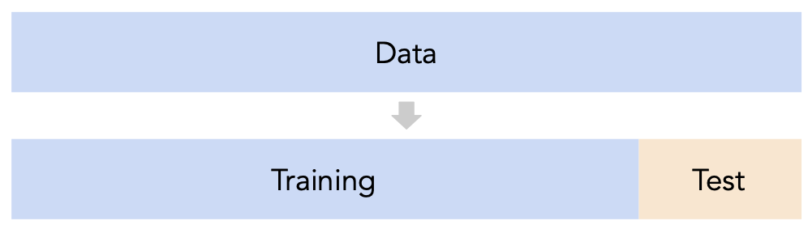



# Homework 9: Practical Machine Learning, Eigenvalues

**due** Tuesday, November 24th, 2026 at 11:59PM Ann Arbor Time

<a class="btn btn-info assignment-pdf-button" href="/resources/homeworks/hw09/hw09.pdf" target="_blank">View as PDF ✏️</a>

{: .yellow }

For Problems 2-5, write your solutions either by writing them on a piece of paper or on a tablet and scanning your answers as a PDF. Note that you are not allowed to use LaTeX, Google Docs, or any other digital document creation software to type your answers. Include the requested screenshots in the same PDF. Submit your PDF, your Problem 1 video link, and your notebook for Problems 6 and 7 to their respective assignments on Pensive by 11:59PM on the due date. See the [syllabus](https://eecs245.org/syllabus/#homeworks) for details on the slip day policy.

Homework will be evaluated not only on the correctness of your answers, but on your ability to present your ideas clearly and logically. You should always explain and justify your conclusions, using sound reasoning. Your goal should be to convince the reader of your assertions. If a question does not require explanation, it will be explicitly stated.

Before proceeding, make sure you're familiar with the [collaboration policy](https://eecs245.org/syllabus/#homeworks).

---

## Problems

- [Problem 1: Midterm 2 Reflection Video](#problem-1-midterm-2-reflection-video-15-pts)
- [Problem 2: Eigenvector Fundamentals](#problem-2-eigenvector-fundamentals-15-pts)
- [Problem 3: Jensen's Inequality](#problem-3-jensens-inequality-15-pts)
- [Problem 4: Home Run!](#problem-4-home-run-14-pts)
- [Problem 5: Polynomial Regression](#problem-5-polynomial-regression-14-pts)
- [Problem 6: One Hot Encoding in sklearn](#problem-6-one-hot-encoding-in-sklearn-13-pts)
- [Problem 7: Implementing Gradient Descent](#problem-7-implementing-gradient-descent-14-pts)

---

Total Points: 15 + 15 + 15 + 14 + 14 + 13 + 14 = 100

---

## Problem 1: Midterm 2 Reflection Video (15 pts)

Record a **2-5 minute video** responding to the following prompt:

> Think of one specific topic you struggled with while studying for Midterm 2. What did you do to make sense of it, and how did it go on the exam? If you were studying for Midterm 2 again, what would you do differently?

The video should be **just you speaking into the camera**. Your face must be visible while you are talking for the entire video. Do not include slides, a screen recording, written work, or any other visuals.

Submit your video link to the separate assignment on Pensive called **Homework 9, Problem 1 Video Link**. You can upload your video to YouTube as unlisted, share a Zoom recording link, or share a Google Drive link; whatever works. Make sure the course staff can view the video using that link.

Your submission time for Homework 9 is the latest of your three submission times: your Problem 1 video link, your PDF, and your notebook.

**This problem is graded on completion.** Record a video of the required length and make an honest effort to explain the question, and you will receive full credit. Your explanation does not need to be polished or perfect.

---

## Problem 2: Eigenvector Fundamentals (15 pts)

For each \\(2 \times 2\\) matrix \\(A\\) below:

<ol class="assignment-list" markdown="1" data-item-count="3" start="1" style="list-style-type: decimal;">
<li markdown="1" value="1">

Find the characteristic polynomial of \\(A\\), and use it to find the eigenvalues of \\(A\\).

</li>
<li markdown="1" value="2">

Find one eigenvector for each eigenvalue of \\(A\\). Verify that each eigenvector is indeed an eigenvector of \\(A\\) by multiplying it by \\(A\\).

</li>
<li markdown="1" value="3">

**By hand (not using Python or Desmos)**, draw a picture (like the one in Chapter 9.1 titled [Visualizing the eigenvectors of \\(A\\)](https://notes.eecs245.org/eigenvalues-and-eigenvectors/eigenvalues-eigenvectors/#a-first-example)) with vectors \\(\vec v&#95;1, A \vec v&#95;1, \vec v&#95;2, A \vec v&#95;2\\) as arrows (where \\(\vec v&#95;1\\) and \\(\vec v&#95;2\\) are the eigenvectors you found above).

</li>
</ol>

a)

(5 pts)
\\(A = \begin{bmatrix} 3 &amp; 4 \\\\ 4 &amp; 3 \end{bmatrix}\\)

b)

(5 pts)
\\(A = \begin{bmatrix} 2 &amp; 1 \\\\ -2 &amp; 8 \end{bmatrix}\\)

c)

(5 pts)
\\(A = \begin{bmatrix} 3 &amp; 0 \\\\ 0 &amp; 4 \end{bmatrix}\\)

---

## Problem 3: Jensen's Inequality (15 pts)

As we've seen several times, the variance of a dataset \\(x&#95;1, x&#95;2, ..., x&#95;n\\) is defined

$$
\sigma_x^2 = \frac{1}{n}\sum_{i=1}^n (x_i - \bar{x})^2
$$

 where \\(\bar{x} = \text{Mean}(x&#95;1, x&#95;2, ..., x&#95;n)\\). By expanding the summation (as we've done in several homework problems), we find that

$$
\sigma_x^2 = \frac{1}{n} \sum_{i = 1}^n x_i^2 - \bar{x}^2
$$

 Another way of expressing this equation is

$$
\sigma_x^2 = \text{Mean}(x_1^2, ..., x_n^2) - (\text{Mean}(x_1, ..., x_n))^2
$$

 Since \\(\sigma&#95;x^2 \geq 0\\), this implies that

$$
\text{Mean}(x_1^2, ..., x_n^2) - (\text{Mean}(x_1, ..., x_n))^2 \ge 0
\implies
\text{Mean}(x_1^2, ..., x_n^2) \geq (\text{Mean}(x_1, ..., x_n))^2
$$

 The inequality on the last line can be expressed more generally as

$$
\boxed{\text{Mean}(g(x_1), g(x_2), ..., g(x_n)) \ge g(\text{Mean}(x_1, ..., x_n))}
$$

 The inequality above holds for all **convex functions** \\(g(x)\\) and is known as Jensen's inequality, named after [Johan Jensen](https://en.wikipedia.org/wiki/Johan_Jensen_%28mathematician%29) (not the former CEO of NVIDIA). Let's see how we can use Jensen's inequality to prove something useful!

a)

(3 pts) Using the second derivative test for convexity, prove that \\(g(x) = -\log(x)\\) is convex across its entire domain, \\((0, \infty)\\). (It would be difficult to prove this using the formal definition of convexity.)

b)

(5 pts) Using Jensen's inequality with \\(g(x) = -\log(x)\\), prove that, for any dataset of positive numbers \\(x&#95;1,x&#95;2,...,x&#95;n\\),

$$
\frac{x_1 + x_2 + ... + x_n}{n} \geq (x_1 \cdot x_2 \cdot ... \cdot x_n)^{1/n}
$$

The quantity on the left is the familiar arithmetic mean (AM), while the quantity on the right is known as the geometric mean (GM) of \\(x&#95;1, x&#95;2, ..., x&#95;n\\). The entire inequality above is known as the "AM-GM inequality".

c)

(7 pts) Using Jensen's inequality with **some** convex function \\(g(x)\\), prove that the arithmetic mean is greater than or equal to the harmonic mean for any dataset of positive numbers \\(x&#95;1,x&#95;2,...,x&#95;n\\), i.e.

$$
\frac{x_1 + x_2 + ... + x_n}{n} \geq \frac{n}{\frac{1}{x_1} + \frac{1}{x_2} + ... + \frac{1}{x_n}}
$$

Note that you must prove your choice of function \\(g(x)\\) is convex (using the second derivative test for convexity)!

<em>Hint: You can use a function that is only convex on an interval, as long as the only inputs you pass into that function are some from that interval.</em>

---

## Problem 4: Home Run! (14 pts)

In this problem, we'll work with a real dataset that describes the number of home runs in the MLB per year. Our goal will be to fit various models that predict the number of home runs, \\(y&#95;i\\), given the year, \\(x&#95;i\\).

Open the **supplemental Jupyter Notebook** we've created for Homework 9, which can either be found [here](https://datahub.eecs245.org/hub/user-redirect/git-pull?repo=https%3A%2F%2Fgithub.com%2Feecs245%2Ffa26-code&urlpath=tree%2Ffa26-code%2Fhomeworks%2Fhw09%2Fhw09.ipynb&branch=main) on DataHub, or by opening `homeworks/hw09/hw09.ipynb` in our [course repository](https://github.com/eecs245/fa26-code/tree/main).

**Note: Many problems in this homework refer to this notebook. For Problems 4 and 5, include the requested work in your PDF. For Problems 6 and 7, submit your completed notebook to the autograder on Pensive.**

In parts **a)** through **c)**, you are given a model. For each one:

<ol class="assignment-list" markdown="1" data-item-count="2" start="1" style="list-style-type: decimal;">
<li markdown="1" value="1">

Implement the necessary data transformations and use `sklearn`'s `LinearRegression` class to fit the model.

</li>
<li markdown="1" value="2">

**In your PDF**, include screenshots of your code and a scatter plot of your model's predictions. Write the formula for \\(h(x&#95;i)\\), the *root* mean squared error, and the \\(R^2\\) score.

</li>
</ol>

Root mean squared error is the square root of mean squared error; its values are in the same units as \\(y\\). The \\(R^2\\) score of a model's predictions is equal to \\(\text{correlation}(\text{actual y values}, \text{predicted y values})^2\\).

There are helper functions in the supplemental Jupyter Notebook to help you with all steps; start by understanding how they work. Part **a)** has been done for you as an example.

a)

\\(h(x&#95;i) = w&#95;0 + w&#95;1 x&#95;i + w&#95;2 x&#95;i^2\\)

b)

(5 pts)
\\(h(x&#95;i) = w&#95;0 + w&#95;1 x&#95;i + w&#95;2 x&#95;i^2 + w&#95;3 x&#95;i^3 + w&#95;4 x&#95;i^4\\)

c)

(5 pts)
\\(h(x&#95;i) = w&#95;0 + w&#95;1 x&#95;i + w&#95;2 (x&#95;i - 1900) \cos\left(\frac{2 \pi}{25} x&#95;i \right) + w&#95;3 e^{\frac{x&#95;i - 1900}{100}}\\)

d)

(4 pts) Explain why we can't use linear regression to fit the model

\\(h(x&#95;i) = w&#95;0 + w&#95;1 x&#95;i + w&#95;2 (x&#95;i - 1900) \cos (w&#95;3 x&#95;i) + w&#95;4 e^{\frac{x&#95;i - 1900}{w&#95;5}}\\).

---

## Problem 5: Polynomial Regression (14 pts)

In this problem, we'll explore the implications of adding more and more complex features to a model.

a)

(5 pts) Suppose \\(\vec y \in \mathbb{R}^n\\) is an observation vector, \\(X\\) is an \\(n \times (d+1)\\) design matrix, and \\(X'\\) is an \\(n \times (d+2)\\) design matrix whose first \\(d+1\\) columns are identical to \\(X\\)'s and whose last column contains some other new information.

$$
X' = \begin{bmatrix} & | \\\\ X & \vec x^{(d+1)} \\\\ & | \end{bmatrix}
$$

These design matrices correspond to models \\(h(\vec x&#95;i)\\) and \\(h'(\vec x&#95;i)\\), in which \\(h'(\vec x&#95;i)\\) includes one additional feature. (The \\('\\) is not a derivative.)

Let \\(\vec w^{\ast} \in \mathbb{R}^{d+1}\\) be a minimizer of \\(\frac{1}{n} \lVert \vec y - X \vec w \rVert^2\\) and \\(\vec w' \in \mathbb{R}^{d+2}\\) be a minimizer of \\(\frac{1}{n} \lVert \vec y - X' \vec w \rVert^2\\). In general, the components of \\(\vec w^{\ast}\\) and \\(\vec w'\\) have no direct relationship; adding a new feature can change the optimal parameters for all of the existing features.

Explain why

$$
\frac{1}{n} \lVert \vec y - X' \vec w' \rVert^2 \leq \frac{1}{n} \lVert \vec y - X \vec w^* \rVert^2
$$

The inequality above is equivalent to the statement "adding a feature never increases the mean squared error of the model's predictions on the data it was trained on".

b)

(5 pts) In the previous part, we had you think about how adding a new feature impacts the model's **training** mean squared error, i.e. its performance on the \\(n\\) data points it was trained on. But, adding new features can hurt a model's performance on unseen data, often called **test** data, which is ultimately the performance we care about. So, to assess a model's ability to **generalize** to unseen data, we typically split our data into a training set and test set, fit the model on just the training set, and then evaluate its performance on the test set.

Here's the general idea we'll explore. Suppose we want to fit a polynomial regression model of degree \\(d\\), i.e. a model of the form

$$
h(x_i) = w_0 + w_1 x_i + w_2 x_i^2 + ... + w_d x_i^d
$$

where \\(x&#95;i\\) is a scalar. The question is, what value of \\(d\\) should we choose? As \\(d\\) increases, the model's training mean squared error will stay the same or decrease. But, its test mean squared error may increase.

Open the **supplemental Jupyter Notebook** we've created for Homework 9, which can either be found [here](https://datahub.eecs245.org/hub/user-redirect/git-pull?repo=https%3A%2F%2Fgithub.com%2Feecs245%2Ffa26-code&urlpath=tree%2Ffa26-code%2Fhomeworks%2Fhw09%2Fhw09.ipynb&branch=main) on DataHub, or by opening `homeworks/hw09/hw09.ipynb` in our [course repository](https://github.com/eecs245/fa26-code/tree/main).

In that notebook, we provide you with code that implements a train-test split, and code that uses `sklearn`'s `Pipeline` and `PolynomialFeatures` classes to quickly fit polynomial regression models of varying degrees.

Your job is to use that code to:

<ol class="assignment-list" markdown="1" data-item-count="4" start="1" style="list-style-type: decimal;">
<li markdown="1" value="1">

Fit 25 polynomial regression models on the training set (degree 1, degree 2, \..., degree 25).

</li>
<li markdown="1" value="2">

For each model, compute both its training and test mean squared error.

</li>
<li markdown="1" value="3">

Create a line plot of the training and test mean squared error vs. degree.

</li>
<li markdown="1" value="4">

**In your PDF**, include screenshots of your code and the resulting plot.

</li>
</ol>

c)

(4 pts) You'll have noticed that the choice of \\(d\\) (degree) with the smallest **test** mean squared error is a relatively small number. (There will be a few values of \\(d\\) with very similar test mean squared errors, but hover over your plot: there is a unique minimum.)

In 1-3 English sentences, explain **why** adding more and more features (i.e. increasing \\(d\\)) leads to worse model performance on the test set, and what lesson we can take from this in the context of building (not necessarily just polynomial) regression models that generalize to unseen data.

If you'd like to learn more about the core ideas explored in this problem, consult [EECS 398: Practical Data Science](https://practicaldsc.org/).

---

## Problem 6: One Hot Encoding in sklearn (13 pts)

In this problem, you'll learn how to use one hot encoding directly in sklearn, as part of a larger modeling pipeline that implements both feature engineering and model training steps. Specifically, you'll implement a regression pipeline that predicts housing prices.

Open the **supplemental Jupyter Notebook** we've created for Homework 9, which can either be found [here](https://datahub.eecs245.org/hub/user-redirect/git-pull?repo=https%3A%2F%2Fgithub.com%2Feecs245%2Ffa26-code&urlpath=tree%2Ffa26-code%2Fhomeworks%2Fhw09%2Fhw09.ipynb&branch=main) on DataHub, or by opening `homeworks/hw09/hw09.ipynb` in our [course repository](https://github.com/eecs245/fa26-code/tree/main).

**This problem is entirely autograded.** Complete both in the notebook and submit it once under **Homework 9, Problems 6 and 7 Code** on Pensive.

---

## Problem 7: Implementing Gradient Descent (14 pts)

In this problem, you'll manually implement gradient descent to fit a line using a custom loss function.

Open the **supplemental Jupyter Notebook** we've created for Homework 9, which can either be found [here](https://datahub.eecs245.org/hub/user-redirect/git-pull?repo=https%3A%2F%2Fgithub.com%2Feecs245%2Ffa26-code&urlpath=tree%2Ffa26-code%2Fhomeworks%2Fhw09%2Fhw09.ipynb&branch=main) on DataHub, or by opening `homeworks/hw09/hw09.ipynb` in our [course repository](https://github.com/eecs245/fa26-code/tree/main).

**This problem is entirely autograded.** Complete both in the notebook and submit it once under **Homework 9, Problems 6 and 7 Code** on Pensive.


