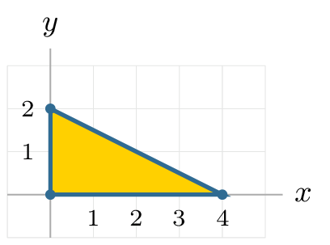
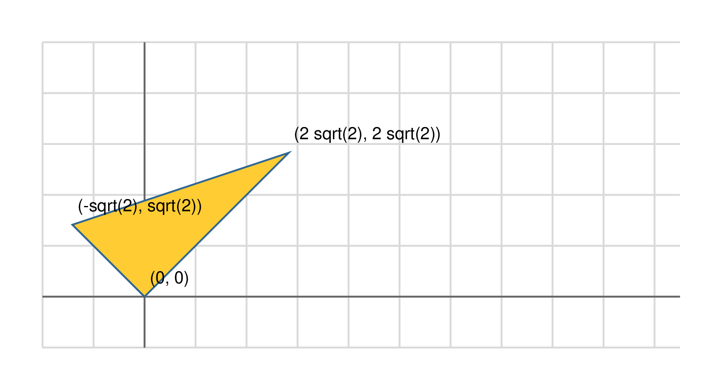
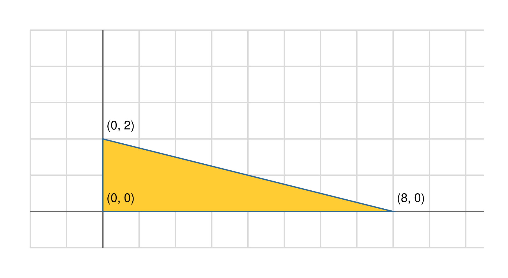
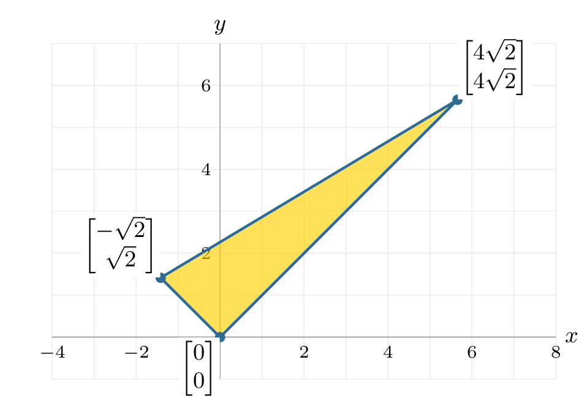
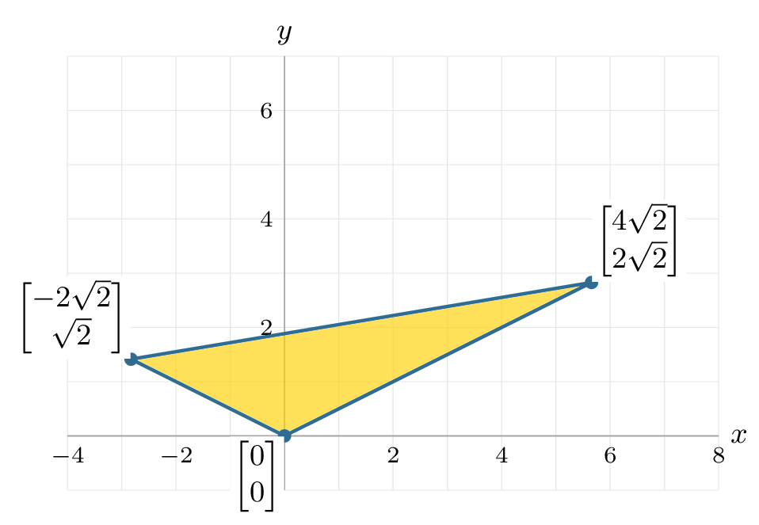



# Lab 6: Rank and Column Space

**due** by the end of your lab section on Wednesday, October 14th, 2026

<a class="btn btn-info assignment-pdf-button" href="/resources/labs/lab06/lab06.pdf" target="_blank">View as PDF ✏️</a>
<a class="btn btn-info assignment-pdf-button" href="/resources/labs/lab06/lab06-solutions.pdf" target="_blank">Solutions PDF ✅</a>

{: .yellow }

Each lab worksheet will contain several activities, some of which will involve writing code and others that will involve writing math on paper. To receive credit for a lab, you must complete all activities and show your lab TA by the end of the lab section.

While you must get checked off by your lab TA **individually**, we encourage you to form groups with 1-2 other students to complete the activities together.

---

## Activities

- [Activity 1: Matrix--Vector Practice](#activity-1-matrix--vector-practice)
- [Activity 2: Fundamentals and CR Decomposition](#activity-2-fundamentals-and-cr-decomposition)
- [Activity 3: Outer Products](#activity-3-outer-products)
- [Activity 4: Transforming a Triangle](#activity-4-transforming-a-triangle)
- [Activity 5: Can We Work Backward?](#activity-5-can-we-work-backward)

---

## Recap: Rank and Column Space ([Chapter 5.3](https://notes.eecs245.org/matrices/rank-and-column-space/))

Suppose \\(A\\) is an \\(n \times d\\) matrix. Then, \\(\text{rank}(A)\\) is the number of linearly independent columns of \\(A\\).

<table>
<thead>
<tr>
<th style="text-align: left;"></th>
<th style="text-align: center;"><strong>Notation</strong></th>
<th style="text-align: left;"><strong>Description</strong></th>
<th style="text-align: center;"><strong>Dimension</strong></th>
<th style="text-align: center;"><strong>Subspace of</strong></th>
</tr>
</thead>
<tbody>
<tr>
<td style="text-align: left;">Column space</td>
<td style="text-align: center;">\(\text{colsp}(A)\)</td>
<td style="text-align: left;">Span of the columns of \(A\)</td>
<td style="text-align: center;">\(\text{rank}(A)\)</td>
<td style="text-align: center;">\(\mathbb{R}^n\)</td>
</tr>
<tr>
<td style="text-align: left;">Row space</td>
<td style="text-align: center;">\(\text{colsp}(A^T)\)</td>
<td style="text-align: left;">Span of the rows of \(A\)</td>
<td style="text-align: center;">\(\text{rank}(A)\)</td>
<td style="text-align: center;">\(\mathbb{R}^d\)</td>
</tr>
</tbody>
</table>

**CR Decomposition**

Suppose \\(A\\) is an \\(n \times d\\) matrix with rank \\(r\\). A CR decomposition of \\(A\\) is a product of two matrices \\(C\\) and \\(R\\), where \\(A = CR\\) and:

<ul class="assignment-list" markdown="1" data-item-count="3">
<li markdown="1">

\\(C\\) is an \\(n \times r\\) matrix and \\(R\\) is a \\(r \times d\\) matrix

</li>
<li markdown="1">

\\(C\\) contains the linearly independent columns of \\(A\\), selected left-to-right

</li>
<li markdown="1">

\\(R\\) tells how to "mix'' the columns of \\(C\\) (which are linearly independent) to reconstruct the columns of \\(A\\)

</li>
</ul>

---

## Activity 1: Matrix--Vector Practice

Compute each product, or explain why it is undefined. For each defined product, state the shape of the output. Show your arithmetic.

a)

\\(\displaystyle \begin{bmatrix}-8&amp;0&amp;0&amp;0&amp;0\\\\0&amp;\frac32&amp;0&amp;0&amp;0\\\\0&amp;0&amp;11&amp;0&amp;0\\\\0&amp;0&amp;0&amp;-5&amp;0\\\\0&amp;0&amp;0&amp;0&amp;7\end{bmatrix} \begin{bmatrix}3\\\\-4\\\\2\\\\6\\\\-3\end{bmatrix}\\)

b)

\\(\displaystyle \begin{bmatrix}12&amp;-7&amp;\frac12&amp;9\end{bmatrix}\begin{bmatrix}3\\\\-2\\\\8\\\\-4\end{bmatrix}\\)

c)

\\(\displaystyle \begin{bmatrix}-5&amp;8&amp;3&amp;12\\\\7&amp;-2&amp;6&amp;-9\end{bmatrix}\begin{bmatrix}4\\\\-1\\\\5\end{bmatrix}\\)

Solution

**(a)** A diagonal matrix scales each coordinate separately:

$$
\begin{bmatrix}-8(3)\\\\(3/2)(-4)\\\\11(2)\\\\-5(6)\\\\7(-3)\end{bmatrix}
=\boxed{\begin{bmatrix}-24\\\\-6\\\\22\\\\-30\\\\-21\end{bmatrix}}
$$

 The output is a \\(5\times1\\) column vector.

**(b)** This is a row-vector--column-vector product:

$$
12(3)+(-7)(-2)+\tfrac12(8)+9(-4)=36+14+4-36=\boxed{18}
$$

 The output has shape \\(1\times1\\) and can be written as a scalar.

**(c)** **Undefined.** The matrix has four columns, but the input has only three entries. We would need one input entry for each of the four columns.

---

## Activity 2: Fundamentals and CR Decomposition

Let \\(X=\begin{bmatrix}1 &amp; 2 &amp; -1 &amp; 3 &amp; 4 &amp; 4 \\\\ 2 &amp; 5 &amp; -2 &amp; 7 &amp; 11 &amp; 10 \\\\ 4 &amp; 8 &amp; -4 &amp; 12 &amp; 16 &amp; 16\end{bmatrix}\\).

a)

Find a basis for \\(\text{colsp}(X)\\). What is \\(\text{rank}(X)\\)? Why? <em>Hint: Column 5 is a linear combination of columns 1 and 2. With this fact, you should be able to answer this relatively quickly.</em>

Solution

Let \\(\vec v&#95;1,\ldots,\vec v&#95;6\\) denote the columns of \\(X\\). The first two columns are not multiples of each other, so they are linearly independent. The remaining columns satisfy

$$
\vec v_3=-\vec v_1,\qquad \vec v_4=\vec v_1+\vec v_2,\qquad
\vec v_5=-2\vec v_1+3\vec v_2,\qquad \vec v_6=2\vec v_2
$$

 Thus the first two columns span the column space, and

$$
\boxed{\text{A basis is }\left\{\begin{bmatrix}1\\\\2\\\\4\end{bmatrix},\begin{bmatrix}2\\\\5\\\\8\end{bmatrix}\right\},\qquad\text{rank}(X)=2}
$$

Let's keep working with \\(X = \begin{bmatrix}1 &amp; 2 &amp; -1 &amp; 3 &amp; 4 &amp; 4 \\\\ 2 &amp; 5 &amp; -2 &amp; 7 &amp; 11 &amp; 10 \\\\ 4 &amp; 8 &amp; -4 &amp; 12 &amp; 16 &amp; 16\end{bmatrix}\\).

b)

Fill in the blanks:

<ul class="assignment-list" markdown="1" data-item-count="2">
<li markdown="1">

\\(\text{colsp}(X)\\) is a \_\_\_\_-dimensional subspace of \_\_\_\_.

</li>
<li markdown="1">

\\(\text{colsp}(X^T)\\) is a \_\_\_\_-dimensional subspace of \_\_\_\_.

</li>
</ul>

Solution

Both spaces have dimension \\(\text{rank}(X)=2\\). The columns of \\(X\\) lie in \\(\mathbb R^3\\), while the columns of \\(X^T\\) lie in \\(\mathbb R^6\\). Thus,

$$
\boxed{\text{colsp}(X)\text{ is a 2-dimensional subspace of }\mathbb R^3}
$$

$$
\boxed{\text{colsp}(X^T)\text{ is a 2-dimensional subspace of }\mathbb R^6}
$$

c)

Find a CR decomposition of \\(X\\). This shouldn't take very much work; review your work from part **a)** in finding a basis for \\(\text{colsp}(X)\\).

Solution

Use the first two columns of \\(X\\) for \\(C\\). Each column of \\(R\\) gives the coefficients needed to reconstruct the corresponding column of \\(X\\):

$$
\boxed{C=\begin{bmatrix}1&2\\\\2&5\\\\4&8\end{bmatrix},\qquad
R=\begin{bmatrix}1&0&-1&1&-2&0\\\\0&1&0&1&3&2\end{bmatrix}}
$$

 For example, the fifth column of \\(R\\) is \\(\begin{bmatrix}-2\\\\3\end{bmatrix}\\) because \\(\vec v&#95;5=-2\vec v&#95;1+3\vec v&#95;2\\). Multiplying verifies

$$
CR=\begin{bmatrix}1&2&-1&3&4&4\\\\2&5&-2&7&11&10\\\\4&8&-4&12&16&16\end{bmatrix}=X
$$

 \\(C\\) has shape \\(3\times2\\) and \\(R\\) has shape \\(2\times6\\).

The key idea being assessed here is that in \\(A = CR\\), the columns of \\(C\\) are linearly independent and a basis for \\(\text{colsp}(A)\\), while the rows of \\(R\\) are linearly independent and a basis for \\(\text{colsp}(A^T)\\)!

---

## Activity 3: Outer Products

Recall that in lecture, we mentioned that you can use the transpose operation to write the dot product of two vectors in \\(\mathbb R^n\\) as a matrix multiplication. For example, let

$$
\vec u=\begin{bmatrix}1\\\\2\\\\-1\\\\3\end{bmatrix},\qquad
\vec v=\begin{bmatrix}2\\\\0\\\\4\\\\-1\end{bmatrix}
$$

 Then,

$$
\vec v^T\vec u=
\begin{bmatrix}2&0&4&-1\end{bmatrix}\begin{bmatrix}1\\\\2\\\\-1\\\\3\end{bmatrix}
=2(1)+0(2)+4(-1)+(-1)(3)=-5=\vec v\cdot\vec u
$$

 A related operation that looks similar but does something very different is the **outer product** of two vectors: \\(\vec u\vec v^T\\) instead of \\(\vec v^T\vec u\\). For the same vectors,

$$
\vec u\vec v^T=
\begin{bmatrix}1\\\\2\\\\-1\\\\3\end{bmatrix}\begin{bmatrix}2&0&4&-1\end{bmatrix}
=\begin{bmatrix}2&0&4&-1\\\\4&0&8&-2\\\\-2&0&-4&1\\\\6&0&12&-3\end{bmatrix}
$$

 The dot product is a scalar; the outer product here is a \\(4\times4\\) matrix.

Suppose \\(A = \vec u \vec v^T + \vec w \vec z^T\\), where \\(\vec u, \vec v, \vec w, \vec z \in \mathbb{R}^n\\) are non-zero vectors.

a)

What is \\(\text{rank}(\vec u \vec v^T)\\)?

Solution

The \\(j\\)th column of \\(\vec u\vec v^T\\) is \\(v&#95;j\vec u\\), so every column is a multiple of \\(\vec u\\). Since \\(\vec v\ne\vec0\\), at least one \\(v&#95;j\\) is nonzero; because \\(\vec u\ne\vec0\\), that column is nonzero. Therefore,

$$
\boxed{\text{rank}(\vec u\vec v^T)=1}
$$

b)

Under what conditions is \\(\text{rank}(A) = 2\\)? What about \\(\text{rank}(A) &lt; 2\\)? <em>Hint: First, think about what happens when multiplying \\(A\\) by a vector \\(\vec x \in \mathbb{R}^n\\). Can you write this as a linear combination of some other vectors? The case for \\(\text{rank}(A) = 2\\) is more complicated than "\\(\vec u\\) and \\(\vec w\\) are linearly independent."</em>

Solution

For every \\(\vec x\in\mathbb R^n\\),

$$
A\vec x=(\vec v^T\vec x)\vec u+(\vec z^T\vec x)\vec w
$$

 so \\(\text{colsp}(A)\subseteq\text{span}(\lbrace\vec u,\vec w\rbrace)\\) and \\(\text{rank}(A)\le2\\).

**Rank 2:** This occurs if and only if both pairs \\(\lbrace\vec u,\vec w\rbrace\\) and \\(\lbrace\vec v,\vec z\rbrace\\) are linearly independent. If either pair is dependent, the columns or rows of \\(A\\) span at most a line, so rank 2 is impossible.

Conversely, suppose both pairs are independent. Then \\(\vec v^T\vec x=c\\) and \\(\vec z^T\vec x=d\\) can be solved for every \\(c,d\in\mathbb R\\), since the two-row coefficient matrix has rank 2 and column space \\(\mathbb R^2\\). Therefore every \\(c\vec u+d\vec w\\) is an output of \\(A\\). Its column space is exactly \\(\text{span}(\lbrace\vec u,\vec w\rbrace)\\), which has dimension 2.

**Rank less than 2:** This occurs if and only if at least one of those pairs is dependent. The rank is 1 unless the two outer products cancel, in which case it is 0. More explicitly, because all four vectors are nonzero,

$$
A=0\quad\Longleftrightarrow\quad
\vec w=c\vec u\text{ and }\vec z=-\frac1c\vec v
\quad\text{for some }c\ne0
$$

 For example, \\(\vec w=\vec u\\) and \\(\vec z=-\vec v\\) give \\(A=0\\).

---

## Activity 4: Transforming a Triangle

The act of multiplying a vector by a matrix performs a **linear transformation** of the vector.

Suppose \\(\vec x=\begin{bmatrix}x\\\\y\end{bmatrix}\\). Multiplying \\(\vec x\\) by the rotation matrix

$$
R_\theta=\begin{bmatrix}\cos\theta&-\sin\theta\\\\\sin\theta&\cos\theta\end{bmatrix}
$$

 gives

$$
R_\theta\vec x=\begin{bmatrix}\cos\theta&-\sin\theta\\\\\sin\theta&\cos\theta\end{bmatrix}\begin{bmatrix}x\\\\y\end{bmatrix}
=\begin{bmatrix}x\cos\theta-y\sin\theta\\\\x\sin\theta+y\cos\theta\end{bmatrix},
$$

 which rotates \\(\vec x\\) counterclockwise by \\(\theta\\) about the origin.

Consider the triangle with vertices \\(\begin{bmatrix}0\\\\0\end{bmatrix}\\), \\(\begin{bmatrix}4\\\\0\end{bmatrix}\\), and \\(\begin{bmatrix}0\\\\2\end{bmatrix}\\).

a)

Let \\(Q=R&#95;{45^\circ}\\). Write \\(Q\\) explicitly, then multiply all three original vertices by \\(Q\\), showing your arithmetic. Draw the corresponding triangle and label its vertices.

Solution

The rotation matrix is

$$
Q=\frac1{\sqrt2}\begin{bmatrix}1&-1\\\\1&1\end{bmatrix}
$$

 Multiplying each vertex gives

$$
Q\begin{bmatrix}0\\\\0\end{bmatrix}=\begin{bmatrix}0\\\\0\end{bmatrix},\qquad
Q\begin{bmatrix}4\\\\0\end{bmatrix}=\frac1{\sqrt2}\begin{bmatrix}4\\\\4\end{bmatrix}=\begin{bmatrix}2\sqrt2\\\\2\sqrt2\end{bmatrix},\qquad
Q\begin{bmatrix}0\\\\2\end{bmatrix}=\frac1{\sqrt2}\begin{bmatrix}-2\\\\2\end{bmatrix}=\begin{bmatrix}-\sqrt2\\\\\sqrt2\end{bmatrix}
$$

 Connect these three points to draw the rotated triangle.

b)

Let \\(D=\begin{bmatrix}2&amp;0\\\\0&amp;1\end{bmatrix}\\). Since \\(D\begin{bmatrix}x\\\\y\end{bmatrix}=\begin{bmatrix}2x\\\\y\end{bmatrix}\\), it stretches a point horizontally by a factor of \\(2\\). Multiply all three original vertices by \\(D\\), showing your arithmetic. Draw the corresponding triangle and label its vertices.

Solution

Multiplication doubles each horizontal coordinate:

$$
D\begin{bmatrix}0\\\\0\end{bmatrix}=\begin{bmatrix}0\\\\0\end{bmatrix},\qquad
D\begin{bmatrix}4\\\\0\end{bmatrix}=\begin{bmatrix}2(4)\\\\0\end{bmatrix}=\begin{bmatrix}8\\\\0\end{bmatrix},\qquad
D\begin{bmatrix}0\\\\2\end{bmatrix}=\begin{bmatrix}2(0)\\\\2\end{bmatrix}=\begin{bmatrix}0\\\\2\end{bmatrix}
$$

 Connect these points to draw the horizontally stretched triangle.

c)

Compute \\(QD\\). For each original vertex \\(\vec x\\), multiply out \\((QD)\vec x\\). Draw the resulting triangle on a coordinate plane and label all three vertices. Explain why \\(QD\\) stretches first and then rotates.

Solution

Stretching first gives \\(D\vec x\\); rotating that result gives \\(Q(D\vec x)\\). Thus the combined matrix is

$$
\boxed{QD=\frac1{\sqrt2}\begin{bmatrix}2&-1\\\\2&1\end{bmatrix}}
$$

 The three vertices become

$$
\begin{bmatrix}0\\\\0\end{bmatrix}\mapsto\begin{bmatrix}0\\\\0\end{bmatrix},\quad
\begin{bmatrix}4\\\\0\end{bmatrix}\mapsto\begin{bmatrix}4\sqrt2\\\\4\sqrt2\end{bmatrix},\quad
\begin{bmatrix}0\\\\2\end{bmatrix}\mapsto\begin{bmatrix}-\sqrt2\\\\\sqrt2\end{bmatrix}
$$

d)

Compute \\(DQ\\). For each original vertex \\(\vec x\\), multiply out \\((DQ)\vec x\\). Draw the resulting triangle on a second coordinate plane with the same scale and label all three vertices. Which operation happens first? How do the triangles for \\(QD\\) and \\(DQ\\) differ?

Solution

Rotating first and stretching second gives

$$
\boxed{DQ=\frac1{\sqrt2}\begin{bmatrix}2&-2\\\\1&1\end{bmatrix}}
$$

 Now the vertices become

$$
\begin{bmatrix}0\\\\0\end{bmatrix}\mapsto\begin{bmatrix}0\\\\0\end{bmatrix},\quad
\begin{bmatrix}4\\\\0\end{bmatrix}\mapsto\begin{bmatrix}4\sqrt2\\\\2\sqrt2\end{bmatrix},\quad
\begin{bmatrix}0\\\\2\end{bmatrix}\mapsto\begin{bmatrix}-2\sqrt2\\\\\sqrt2\end{bmatrix}
$$

The first triangle is taller and narrower. It still has a right angle at the origin: stretching along the original coordinate axes preserves that right angle, and rotating preserves all angles. In the second triangle, stretching after rotation changes the angle between the tilted sides, so the angle at the origin is no longer a right angle.

Note that the last page of this worksheet is empty if you need extra space to draw.

---

## Activity 5: Can We Work Backward?

Let \\(\displaystyle A=\begin{bmatrix}4&amp;-6\\\\-2&amp;3\end{bmatrix}\\).

a)

Find two different vectors \\(\vec u\\) and \\(\vec v\\) such that \\(A\vec u=A\vec v=\begin{bmatrix}12\\\\-6\end{bmatrix}\\).

Solution

The system is

$$
4x-6y=12,\qquad -2x+3y=-6
$$

 The second equation is \\(-1/2\\) times the first, so there is only one independent restriction. Solving gives \\(x=3+\tfrac32y\\). Choosing \\(y=0\\) and \\(y=2\\), for example, gives

$$
\boxed{\vec u=\begin{bmatrix}3\\\\0\end{bmatrix},\qquad
\vec v=\begin{bmatrix}6\\\\2\end{bmatrix}}
$$

 Indeed, both products are \\(\begin{bmatrix}12\\\\-6\end{bmatrix}\\).

b)

Is there a vector \\(\vec x\\) such that \\(A\vec x=\begin{bmatrix}12\\\\-5\end{bmatrix}\\)? In your answer, reference \\(\text{colsp}(A)\\).

Solution

**No.** The second column is \\(-3/2\\) times the first, so every output is in

$$
\operatorname{span}\!\left(\begin{bmatrix}4\\\\-2\end{bmatrix}\right)
$$

 Every vector in this span has second entry equal to \\(-1/2\\) times its first entry. An output with first entry \\(12\\) must have second entry \\(-6\\), not \\(-5\\).

c)

Using your \\(\vec u\\) and \\(\vec v\\) from part (a), find a nonzero vector \\(\vec w\\) such that \\(A\vec w=\vec0\\).

Solution

Subtract the two inputs from part (a):

$$
\boxed{\vec v-\vec u=\begin{bmatrix}3\\\\2\end{bmatrix}}
$$

 This vector is nonzero, and linearity gives

$$
A(\vec v-\vec u)=A\vec v-A\vec u
=\begin{bmatrix}12\\\\-6\end{bmatrix}-\begin{bmatrix}12\\\\-6\end{bmatrix}=\vec0
$$


