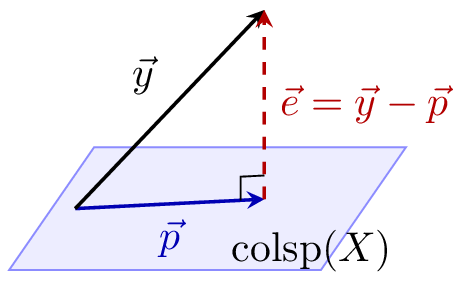



# Lab 8: Linear Transformations, Inverses, and Projections

**due** by the end of your lab section on Wednesday, October 28th, 2026

<a class="btn btn-info assignment-pdf-button" href="/resources/labs/lab08/lab08.pdf" target="_blank">View as PDF ✏️</a>
<a class="btn btn-info assignment-pdf-button" href="/resources/labs/lab08/lab08-solutions.pdf" target="_blank">Solutions PDF ✅</a>

{: .yellow }

Each lab worksheet will contain several activities, some of which will involve writing code and others that will involve writing math on paper. To receive credit for a lab, you must complete all activities and show your lab TA by the end of the lab section.

While you must get checked off by your lab TA **individually**, we encourage you to form groups with 1-2 other students to complete the activities together.

---

## Activities

- [Activity 1: PrairieLearn Practice Problems](#activity-1-prairielearn-practice-problems)
- [Activity 2: Symbolic Inverses](#activity-2-symbolic-inverses)
- [Activity 3: Can $A$ Be Invertible?](#activity-3-can-a-be-invertible)
- [Activity 4: Linear Transformations](#activity-4-linear-transformations)
- [Activity 5: Projecting onto the Column Space](#activity-5-projecting-onto-the-column-space)

---

## Recap: Linear Transformations ([Chapter 6.1](https://notes.eecs245.org/linear-transformations-and-projections/linear-transformations/)) and Inverses ([Chapter 6.2](https://notes.eecs245.org/linear-transformations-and-projections/inverses/))

<ul class="assignment-list" markdown="1" data-item-count="4">
<li markdown="1">

A linear transformation is a function \\(\mathbb{R}^d \to \mathbb{R}^n\\) such that

$$
f(\vec x + \vec y) = f(\vec x) + f(\vec y), \qquad f(c \vec x) = c f(\vec x)
$$

<ul class="assignment-list" markdown="1" data-item-count="2">
<li markdown="1">

Every linear transformation has a corresponding \\(n \times d\\) matrix \\(A\\) where \\(f(\vec x) = A \vec x\\).

</li>
<li markdown="1">

If \\(A\\) is square, then \\(f(\vec x) = A \vec x\\) is a function from \\(\mathbb{R}^n\\) to \\(\mathbb{R}^n\\), and \\(A\\) is invertible if and only if the function \\(f\\) is invertible.

</li>
</ul>
</li>
<li markdown="1">

An \\(n \times n\\) square matrix \\(A\\) is **invertible** if and only if \\(\text{rank}(A) = n\\), which also means that \\(A\\)'s columns are linearly independent (along with several other equivalent conditions).

</li>
<li markdown="1">

If \\(A\\) is invertible, then its **inverse** \\(A^{-1}\\) is the **unique** \\(n \times n\\) matrix such that \\(AA^{-1}=I=A^{-1}A\\).

</li>
<li markdown="1">

The **determinant** of an \\(n \times n\\) square matrix \\(A\\), denoted \\(\text{det}(A)\\), is defined so that \\(|\text{det}(A)|\\) is the \\(n\\)-dimensional volume of the parallelepiped spanned by the columns of \\(A\\).

<ul class="assignment-list" markdown="1" data-item-count="3">
<li markdown="1">

If \\(\text{det}(A) = 0\\), then \\(A\\) is not invertible.

</li>
<li markdown="1">

If \\(A = \begin{bmatrix} a &amp; b \\\\ c &amp; d \end{bmatrix}\\), then \\(\text{det}(A) = ad - bc\\) and \\(A^{-1} = \frac{1}{ad - bc} \begin{bmatrix} d &amp; -b \\\\ -c &amp; a \end{bmatrix}\\).

</li>
<li markdown="1">

The determinant satisfies several properties, including that \\(\text{det}(AB) = \text{det}(A) \text{det}(B)\\) and \\(\text{det}(A^T) = \text{det}(A)\\).

</li>
</ul>
</li>
</ul>

---

## Activity 1: PrairieLearn Practice Problems

We're testing out a new website for practicing linear algebra problems: PrairieLearn.

On the course website, under Lab 8, click the "PrairieLearn" link to access the relevant problems for this activity. It consists of 6 problems, each worth 1 point. The numbers in the problems are randomized; everyone will receive slightly different problems.

You can also [**access the problems here**](https://us.prairielearn.com/pl/course_instance/236398/assessment/2742917) when reviewing.

To get credit for Activity 1, you must **eventually** correctly answer all 6 problems, earning a score of 6/6. If you answer a problem incorrectly, click "New Variant" to generate a new version and then try again. There is no penalty for answering a problem incorrectly, as long as you eventually get it correct.

To get checked off for Activity 1, show your lab TA that you have earned a score of 6/6 on PrairieLearn.

If you can't access PrairieLearn, post on Ed or email Suraj.

---

## Activity 2: Symbolic Inverses

Given that \\(A\\) is an invertible \\(n \times n\\) matrix that satisfies \\(A^4 - 3A^2 + 2A - 4I = 0\\), find an expression for \\(A^{-1}\\) in terms of \\(A\\).

Solution

The goal is to find another matrix \\(B\\) such that \\(AB = BA = I\\). We can do this by isolating the identity matrix, \\(I\\), and then trying to write the other side of the equation as \\(A\\) times some other matrix.

$$
\begin{align*}
A^4 - 3A^2 + 2A - 4I &= 0 \\\\
A^4 - 3A^2 + 2A &= 4I \\\\
A(A^3 - 3A + 2I) &= 4I \\\\
A \left( \frac{1}{4}(A^3 - 3A + 2I) \right) &= I
\end{align*}
$$

So, \\(\boxed{A^{-1} = \frac{1}{4}(A^3 - 3A + 2I)}\\).

---

## Activity 3: Can \\(A\\) Be Invertible?

Suppose \\(A\\) is a \\(3\times3\\) matrix such that

$$
A\begin{bmatrix}5\\\\-1\\\\2\end{bmatrix}
=A\begin{bmatrix}1\\\\3\\\\2\end{bmatrix}
$$

 Is \\(A\\) invertible? Why or why not?

Solution

No. If \\(A\\) were invertible, we could multiply both sides by \\(A^{-1}\\) to get

$$
\begin{bmatrix}5\\\\-1\\\\2\end{bmatrix}=\begin{bmatrix}1\\\\3\\\\2\end{bmatrix}
$$

 But these vectors aren't equal, so \\(A\\) can't be invertible.

Equivalently, the distributive property of matrix multiplication tells us that

$$
A\begin{bmatrix}5\\\\-1\\\\2\end{bmatrix}-A\begin{bmatrix}1\\\\3\\\\2\end{bmatrix}=\vec0
\quad\Longrightarrow\quad
A\begin{bmatrix}4\\\\-4\\\\0\end{bmatrix}=\vec0
$$

 This means that \\(\begin{bmatrix}4\\\\-4\\\\0\end{bmatrix}\in\text{nullsp}(A)\\). Since this is a non-zero vector, \\(A\\) does not have linearly independent columns and is not invertible.

---

## Activity 4: Linear Transformations

[**Watch the TA walkthrough for Activity 4.**](https://youtu.be/r5N26V-WEaA)

<iframe width="560" height="315" src="https://www.youtube.com/embed/r5N26V-WEaA" title="YouTube video player" frameborder="0" allow="accelerometer; autoplay; clipboard-write; encrypted-media; gyroscope; picture-in-picture; web-share" referrerpolicy="strict-origin-when-cross-origin" allowfullscreen></iframe>

Suppose \\(f: \mathbb{R}^3 \to \mathbb{R}^3\\) is a linear transformation represented by the matrix \\(A\\).

Furthermore, suppose that \\(f\left(\begin{bmatrix} 1 \\\\ 0 \\\\ 0 \end{bmatrix}\right) = \begin{bmatrix} 0 \\\\ 3 \\\\ 4 \end{bmatrix}\\), \\(f\left(\begin{bmatrix} 0 \\\\ 10 \\\\ 0 \end{bmatrix}\right) = \begin{bmatrix} 0 \\\\ 4 \\\\ -3 \end{bmatrix}\\), and \\(f\left(\begin{bmatrix} 0 \\\\ 0 \\\\ 1 \end{bmatrix}\right) = \begin{bmatrix} 1 \\\\ 0 \\\\ 0 \end{bmatrix}\\).

a)

Find \\(f\left(\begin{bmatrix} 2 \\\\ 1 \\\\ 2 \end{bmatrix}\right)\\). **After that**, find the matrix \\(A\\) corresponding to \\(f\\), i.e. where \\(f(\vec x) = A \vec x\\).

Solution

First, using just the properties of linear transformations, we can find \\(f\left(\begin{bmatrix} 2 \\\\ 1 \\\\ 2 \end{bmatrix}\right)\\). Recall that a linear transformation \\(f:\mathbb R^3\to\mathbb R^3\\) satisfies

<ul class="assignment-list" markdown="1" data-item-count="2">
<li markdown="1">

\\(f(\vec x + \vec y) = f(\vec x) + f(\vec y)\\), for all \\(\vec x,\vec y\in\mathbb R^3\\).

</li>
<li markdown="1">

\\(f(c \vec x) = c f(\vec x)\\), for all \\(\vec x\in\mathbb R^3\\) and \\(c\in\mathbb R\\).

</li>
</ul>

In other words, \\(f\\) preserves linear combinations: \\(f(a \vec x + b \vec y) = a f(\vec x) + b f(\vec y)\\).

Let's decompose \\(f\left(\begin{bmatrix} 2 \\\\ 1 \\\\ 2 \end{bmatrix}\right)\\) into a linear combination of outputs we already know.

$$
\begin{align*}
f\left(\begin{bmatrix} 2 \\\\ 1 \\\\ 2 \end{bmatrix}\right)
&= f\left(2 \begin{bmatrix} 1 \\\\ 0 \\\\ 0 \end{bmatrix} + \frac{1}{10} \begin{bmatrix} 0 \\\\ 10 \\\\ 0 \end{bmatrix} + 2 \begin{bmatrix} 0 \\\\ 0 \\\\ 1 \end{bmatrix}\right) \\\\
&= \underbrace{2 f\left(\begin{bmatrix} 1 \\\\ 0 \\\\ 0 \end{bmatrix}\right)
+ \frac{1}{10} f\left(\begin{bmatrix} 0 \\\\ 10 \\\\ 0 \end{bmatrix}\right)
+ 2 f\left(\begin{bmatrix} 0 \\\\ 0 \\\\ 1 \end{bmatrix}\right)}_\text{property of linear transformations} \\\\
&= 2 \begin{bmatrix} 0 \\\\ 3 \\\\ 4 \end{bmatrix} + \frac{1}{10} \begin{bmatrix} 0 \\\\ 4 \\\\ -3 \end{bmatrix} + 2 \begin{bmatrix} 1 \\\\ 0 \\\\ 0 \end{bmatrix} \\\\
&= \begin{bmatrix} 0 \\\\ 6 \\\\ 8 \end{bmatrix} + \begin{bmatrix} 0 \\\\ 4 / 10 \\\\ -3 / 10 \end{bmatrix} + \begin{bmatrix} 2 \\\\ 0 \\\\ 0 \end{bmatrix} \\\\
&= \begin{bmatrix} 2 \\\\ 6.4 \\\\ 7.7 \end{bmatrix}
\end{align*}
$$

So, \\(f\left(\begin{bmatrix} 2 \\\\ 1 \\\\ 2 \end{bmatrix}\right) = \begin{bmatrix} 2 \\\\ 6.4 \\\\ 7.7 \end{bmatrix}\\).

Next, we need to find the matrix \\(A\\) corresponding to \\(f\\), i.e. where \\(f(\vec x) = A \vec x\\). Since \\(f\\) is a linear transformation, we know that \\(f(\vec x) = A \vec x\\) for some matrix \\(A\\).

<ul class="assignment-list" markdown="1" data-item-count="3">
<li markdown="1">

The first column of \\(A\\) is given by \\(f\left(\begin{bmatrix} 1 \\\\ 0 \\\\ 0 \end{bmatrix}\right)\\), which we're told is \\(\begin{bmatrix} 0 \\\\ 3 \\\\ 4 \end{bmatrix}\\).

</li>
<li markdown="1">

The second column of \\(A\\) is given by \\(f\left(\begin{bmatrix} 0 \\\\ 1 \\\\ 0 \end{bmatrix}\right)\\), which we've computed above to be \\(\begin{bmatrix} 0 \\\\ 4/10 \\\\ -3/10 \end{bmatrix}\\).

</li>
<li markdown="1">

The third column of \\(A\\) is given by \\(f\left(\begin{bmatrix} 0 \\\\ 0 \\\\ 1 \end{bmatrix}\right)\\), which we're told is \\(\begin{bmatrix} 1 \\\\ 0 \\\\ 0 \end{bmatrix}\\).

</li>
</ul>

So,

$$
A = \begin{bmatrix} 0 & 0 & 1 \\\\ 3 & 4 / 10 & 0 \\\\ 4 & -3 / 10 & 0 \end{bmatrix}
$$

You can verify that multiplying \\(A\\) by \\(\begin{bmatrix} 2 \\\\ 1 \\\\ 2 \end{bmatrix}\\) gives us \\(\begin{bmatrix} 2 \\\\ 6.4 \\\\ 7.7 \end{bmatrix}\\), and that multiplying \\(A\\) by the three vectors in the question give the outputs we're told. Remember that \\(A \begin{bmatrix} 1 \\\\ 0 \\\\ 0 \end{bmatrix}\\) returns just the first column of \\(A\\), and so on.

b)

Find a **diagonal** matrix \\(D\\) and an **orthogonal** matrix \\(Q\\) such that \\(A = QD\\). (Not every matrix can be written in this form, but this particular \\(A\\) can.) Then, describe **in English** how \\(f\\) transforms a vector \\(\vec x\\).

Solution

Remember that

<ul class="assignment-list" markdown="1" data-item-count="2">
<li markdown="1">

Diagonal matrices have 0s everywhere except on the diagonal, and have the effect of stretching/compressing each axis/dimension of the input vector independently.

</li>
<li markdown="1">

Orthogonal matrices have columns that are orthonormal, meaning their columns are unit vectors that are orthogonal to one another.

</li>
</ul>

In

$$
A = \begin{bmatrix} 0 & 0 & 1 \\\\ 3 & 4 / 10 & 0 \\\\ 4 & -3 / 10 & 0 \end{bmatrix}
$$

You might notice that \\(A\\)'s first column is 5 times \\(\begin{bmatrix} 0 \\\\ 3/5 \\\\ 4/5 \end{bmatrix}\\), which is a unit vector. You might also notice that \\(A\\)'s second column is \\((1/2)\\) times \\(\begin{bmatrix} 0 \\\\ 4/5 \\\\ -3/5 \end{bmatrix}\\), which is another unit vector orthogonal to the first column. And finally, \\(A\\)'s third column is already a unit vector, and its orthogonal to the first two columns.

So, if we put these orthogonal unit vectors into the columns of \\(Q\\), and the scaling factors of \\(5\\), \\(1/2\\), and \\(1\\) into the diagonal of \\(D\\), we have

$$
A = \begin{bmatrix} 0 & 0 & 1 \\\\ 3 & 4 / 10 & 0 \\\\ 4 & -3 / 10 & 0 \end{bmatrix} = \underbrace{\begin{bmatrix} 0 & 0 & 1 \\\\ 3/5 & 4/5 & 0 \\\\ 4/5 & -3/5 & 0 \end{bmatrix}}_Q \underbrace{\begin{bmatrix} 5 & 0 & 0 \\\\ 0 & 1 / 2 & 0 \\\\ 0 & 0 & 1 \end{bmatrix}}_D
$$

So, \\(Q = \begin{bmatrix} 0 &amp; 0 &amp; 1 \\\\ 3/5 &amp; 4/5 &amp; 0 \\\\ 4/5 &amp; -3/5 &amp; 0 \end{bmatrix}\\) and \\(D = \begin{bmatrix} 5 &amp; 0 &amp; 0 \\\\ 0 &amp; 1 / 2 &amp; 0 \\\\ 0 &amp; 0 &amp; 1 \end{bmatrix}\\).

\\(f(\vec x) = QD \vec x\\) transforms \\(f\\) by first scaling \\(\vec x\\)'s first component by 5, second component by 1/2, and leaving the third component as-is, and then applying the orthogonal matrix \\(Q\\).

Orthogonal matrices preserve lengths and angles; they may include reflections. This particular \\(Q\\) reverses orientation. It's harder to describe rotations in \\(\mathbb{R}^3\\) and beyond, but the key property that describes the effect of an orthogonal matrix \\(Q\\) is that for any vector \\(\vec x\\),

$$
\lVert Q \vec x \rVert = \lVert \vec x \rVert
$$

as follows from \\(Q^TQ=I\\), meaning that all an orthogonal matrix is doing is changing the angle of the vector, not its length.

So, \\(f(\vec x)\\) first scales \\(\vec x\\)'s components, and then applies \\(Q\\) to the resulting vector.

c)

Using your \\(A = QD\\) decomposition from part **b)**, find \\(A^{-1}\\).

<em>Hint: Recall that for orthogonal matrices, \\(QQ^T = Q^TQ = I\\). And, for any invertible matrices \\(A\\) and \\(B\\), \\((AB)^{-1} = B^{-1}A^{-1}\\).</em>

Solution

Since \\(A = QD\\), we have

$$
A^{-1} = D^{-1}Q^{-1}
$$

Since \\(D\\) is diagonal, its inverse is just the diagonal matrix with the reciprocal of each diagonal entry. This corresponds to "unstretching" the vector in each dimension. So,

$$
D^{-1} = \begin{bmatrix} 1 / 5 & 0 & 0 \\\\ 0 & 2 & 0 \\\\ 0 & 0 & 1 \end{bmatrix}
$$

And, since \\(Q\\) is orthogonal, we know \\(Q^TQ = I\\), meaning that \\(Q^{-1} = Q^T\\), i.e. \\(Q\\)'s inverse is its transpose. This corresponds to "undoing" the orthogonal transformation of the vector.

$$
Q^{-1} = Q^T = \begin{bmatrix} 0 & 3/5 & 4/5 \\\\ 0 & 4/5 & -3/5 \\\\ 1 & 0 & 0 \end{bmatrix}
$$

Putting these building blocks together gives us

$$
A^{-1} = D^{-1}Q^{-1} = D^{-1}Q^T = \begin{bmatrix} 1 / 5 & 0 & 0 \\\\ 0 & 2 & 0 \\\\ 0 & 0 & 1 \end{bmatrix} \begin{bmatrix} 0 & 3/5 & 4/5 \\\\ 0 & 4/5 & -3/5 \\\\ 1 & 0 & 0 \end{bmatrix} = \begin{bmatrix} 0 & 3/25 & 4/25 \\\\ 0 & 8/5 & -6/5 \\\\ 1 & 0 & 0 \end{bmatrix}
$$

d)

Using the scaling factors from part **b)**, find \\(|\text{det}(A)|\\). (You can verify your work using the formula in [Chapter 6.1](https://notes.eecs245.org/linear-transformations-and-projections/linear-transformations/#the-determinant).)

Solution

Since \\(Q\\) is orthogonal, \\(Q^TQ=I\\). Taking determinants gives

$$
\text{det}(Q^TQ)=\text{det}(I)=1
$$

 Using \\(\text{det}(AB)=\text{det}(A)\text{det}(B)\\) and \\(\text{det}(Q^T)=\text{det}(Q)\\), we get

$$
\text{det}(Q)^2=1\quad\Longrightarrow\quad |\text{det}(Q)|=1
$$

 So, since \\(A=QD\\),

$$
|\text{det}(A)|=|\text{det}(Q)|\,|\text{det}(D)|=1\cdot5\cdot\frac12=\boxed{\frac52}
$$

---

## Activity 5: Projecting onto the Column Space

The next big idea in the course is finding the projection of a vector \\(\vec y\in\mathbb R^n\\) onto the column space of an \\(n\times d\\) matrix \\(X\\).

Let

$$
X=\begin{bmatrix}2&1\\\\0&-3\\\\0&0\end{bmatrix},\qquad
\vec y=\begin{bmatrix}2\\\\3\\\\4\end{bmatrix}
$$

a)

Fill in the blank: \\(\text{colsp}(X)\\) is a \_\_\_\_ in \\(\mathbb R^3\\).

Solution

A **plane**. The columns are linearly independent and both have third component 0, so their span is the plane of vectors whose third component is 0. In other words, \\(\text{colsp}(X)\\) is the \\(xy\\)-plane in \\(\mathbb R^3\\), which is the plane \\(z=0\\).

b)

Which vector in \\(\text{colsp}(X)\\) is closest to \\(\vec y\\)? Normally, this would require more calculation, but it is possible to see the answer here without much work. Explain your thought process.

Solution

Every vector in \\(\text{colsp}(X)\\) has third component 0. So, we can't match the third component of \\(\vec y\\), but we can match its first two components exactly, because the two columns of \\(X\\) are linearly independent and span a plane (and the set of vectors with \\(z=0\\) is a plane). This gives

$$
\boxed{\vec p=\begin{bmatrix}2\\\\3\\\\0\end{bmatrix}}
$$

 Changing either of the first two components would only move us farther from \\(\vec y\\).

We'll call the vector you found \\(\vec p\\).

c)

Find the error vector \\(\vec e=\vec y-\vec p\\).

Solution

Subtracting gives

$$
\vec e=\vec y-\vec p=\begin{bmatrix}2\\\\3\\\\4\end{bmatrix}-\begin{bmatrix}2\\\\3\\\\0\end{bmatrix}=\boxed{\begin{bmatrix}0\\\\0\\\\4\end{bmatrix}}
$$

d)

Verify that \\(\vec e\\) is orthogonal to each column of \\(X\\).

Solution

Taking the dot product with each column gives

$$
\begin{bmatrix}0\\\\0\\\\4\end{bmatrix}\cdot\begin{bmatrix}2\\\\0\\\\0\end{bmatrix}=0,\qquad
\begin{bmatrix}0\\\\0\\\\4\end{bmatrix}\cdot\begin{bmatrix}1\\\\-3\\\\0\end{bmatrix}=0
$$

 Both dot products are 0, so \\(\vec e\\) is orthogonal to both columns.

e)

Find \\(\vec w^{\ast}\in\mathbb R^2\\) such that \\(X\vec w^{\ast}=\vec p\\).

Solution

Writing out \\(X\vec w^{\ast}=\vec p\\) gives

$$
2w_1^*+w_2^*=2,\qquad -3w_2^*=3
$$

 The second equation gives \\(w&#95;2^{\ast}=-1\\). Substituting into the first gives \\(2w&#95;1^{\ast}-1=2\\), so

$$
\boxed{\vec w^*=\begin{bmatrix}3/2\\\\-1\end{bmatrix}}
$$

We were able to find \\(\vec p\\) without much calculation because of the particular \\(X\\) and \\(\vec y\\) we chose. But we need a **more general-purpose solution**, one that works for any \\(n\times d\\) matrix \\(X\\) and any \\(\vec y\in\mathbb R^n\\). We can't rely on being able to see the answer, especially when \\(n&gt;3\\)!

**Important: Every vector in \\(\text{colsp}(X)\\) can be written as \\(X\vec w\\) for some \\(\vec w\in\mathbb R^d\\).**

Our goal is to find \\(\vec w\\) so that the error \\(\vec e=\vec y-X\vec w\\) is orthogonal to every column of \\(X\\). Let \\(\vec x^{(1)},\ldots,\vec x^{(d)}\\) be the columns of \\(X\\).

f)

Fill in the blank: For \\(\vec e\\) to be orthogonal to every column of \\(X\\), we need

$$
\vec x^{(1)}\cdot\vec e=0,\quad\ldots,\quad\vec x^{(d)}\cdot\vec e=0,
$$

 which we can write as a single matrix-vector product:

$$
\_\_\_\_\;\vec e=\vec0
$$

Solution

The blank is \\(\boxed{X^T}\\). Each row of \\(X^T\\) is the transpose of a column of \\(X\\), so the components of \\(X^T\vec e\\) are exactly the dot products listed above.

g)

Substitute \\(\vec e=\vec y-X\vec w\\) into your equation and rearrange it to fill in the blanks below. This is called the **normal equation**.

$$
\underbrace{\_\_\_\_}_{d\times d}\,\vec w
=\underbrace{\_\_\_\_}_{d\times1}
$$

Solution

Starting with \\(X^T\vec e=\vec0\\), substitute \\(\vec e=\vec y-X\vec w\\):

$$
\begin{align*}
X^T(\vec y-X\vec w)&=\vec0\\\\
X^T\vec y-X^TX\vec w&=\vec0\\\\
\boxed{X^TX}\,\vec w&=\boxed{X^T\vec y}
\end{align*}
$$

The normal equation describes the condition we want for any \\(n\times d\\) matrix \\(X\\). To solve it using an inverse, we'll now assume that \\(X\\)'s columns are linearly independent.

h)

Explain why \\(X^TX\\) is invertible under this assumption. <em>Hint: Recall that \\(\text{rank}(X^TX)=\text{rank}(X)\\), as explained in <a href="https://www.youtube.com/watch?v=hOyaHqGmO1I">this video</a>.</em>

Solution

Since \\(X\\) has \\(d\\) linearly independent columns, \\(\text{rank}(X)=d\\). We also know that \\(\text{rank}(X^TX)=\text{rank}(X)\\), so \\(\text{rank}(X^TX)=d\\).

But \\(X^TX\\) is a \\(d\times d\\) square matrix. Its rank equals its number of columns, so it is invertible.

i)

Solve the normal equation for \\(\vec w\\) by multiplying both sides by an appropriate inverse. Call your solution \\(\vec w^{\ast}\\).

Solution

Multiplying both sides on the left by \\((X^TX)^{-1}\\) gives

$$
\begin{align*}
(X^TX)^{-1}X^TX\vec w&=(X^TX)^{-1}X^T\vec y\\\\
\vec w&=(X^TX)^{-1}X^T\vec y
\end{align*}
$$

So, \\(\boxed{\vec w^{\ast}=(X^TX)^{-1}X^T\vec y}\\).

The closest vector in \\(\text{colsp}(X)\\) to \\(\vec y\\) is \\(\vec p=X\vec w^{\ast}\\). We call \\(\vec p\\) the **projection** of \\(\vec y\\) onto \\(\text{colsp}(X)\\).

Now, let's try our method with a different \\(X\\):

$$
X=\begin{bmatrix}1&1\\\\1&-1\\\\1&0\end{bmatrix},\qquad
\vec y=\begin{bmatrix}2\\\\3\\\\4\end{bmatrix}
$$

j)

Use the normal equation to find \\(\vec w^{\ast}\\).

Solution

First, compute the two sides of the normal equation:

$$
X^TX=\begin{bmatrix}3&0\\\\0&2\end{bmatrix},\qquad
X^T\vec y=\begin{bmatrix}9\\\\-1\end{bmatrix}
$$

 So, we need to solve

$$
\begin{bmatrix}3&0\\\\0&2\end{bmatrix}\vec w^*=\begin{bmatrix}9\\\\-1\end{bmatrix}
$$

 This gives \\(3w&#95;1^{\ast}=9\\) and \\(2w&#95;2^{\ast}=-1\\), so

$$
\boxed{\vec w^*=\begin{bmatrix}3\\\\-1/2\end{bmatrix}}
$$

k)

Find the projection \\(\vec p\\) of \\(\vec y\\) onto \\(\text{colsp}(X)\\).

Solution

Multiplying by \\(X\\) gives

$$
\vec p=X\vec w^*=\begin{bmatrix}1&1\\\\1&-1\\\\1&0\end{bmatrix}\begin{bmatrix}3\\\\-1/2\end{bmatrix}=\boxed{\begin{bmatrix}5/2\\\\7/2\\\\3\end{bmatrix}}
$$

l)

Find the error vector \\(\vec e=\vec y-\vec p\\).

Solution

Subtracting gives

$$
\vec e=\vec y-\vec p=\begin{bmatrix}2\\\\3\\\\4\end{bmatrix}-\begin{bmatrix}5/2\\\\7/2\\\\3\end{bmatrix}=\boxed{\begin{bmatrix}-1/2\\\\-1/2\\\\1\end{bmatrix}}
$$

m)

Why do the components of \\(\vec e\\) sum to 0 in this example, but not in the first example in this activity?

Solution

In both parts, \\(X^T \vec e = \begin{bmatrix} 0 \\\\ 0 \end{bmatrix}\\), but only in this new example is the sum of the components in \\(\vec e\\) exactly 0 (in the first example, it's 4).

This has to do with the fact that in each case, \\(\vec e\\) is orthogonal to **any linear combination of the columns of \\(X\\)**. This is what it means for \\(\vec e\\) to be orthogonal to \\(\text{colsp}(X)\\).

In the second example, one of the columns of \\(X\\) is \\(\begin{bmatrix} 1 \\\\ 1 \\\\ 1 \end{bmatrix}\\), meaning that \\(\vec e \cdot \begin{bmatrix} 1 \\\\ 1 \\\\ 1 \end{bmatrix} = e&#95;1 + e&#95;2 + e&#95;3 = 0\\). However, no linear combination of the columns of \\(X\\) in the first example gives a vector of \\(\begin{bmatrix} 1 \\\\ 1 \\\\ 1 \end{bmatrix}\\), so we can't use this logic to guarantee the error vector's components sum to 0 in the first example. (I say "guarantee" because while the error vector's components don't sum to 0 for \\(\vec y = \begin{bmatrix} 2 \\\\ 3 \\\\ 4 \end{bmatrix}\\), they still could for some other \\(\vec y\\) projected onto the column space of \\(X\\) in the first example.)

**Don't forget this fact**: the existence of a column of 1's in \\(X\\) (or in \\(X\\)'s column space) guarantees that the error vector \\(\vec e\\) when projecting \\(\vec y\\) onto \\(\text{colsp}(X)\\) will have a sum of components equal to 0, no matter what the other columns of \\(X\\) are and no matter what \\(\vec y\\) is.


